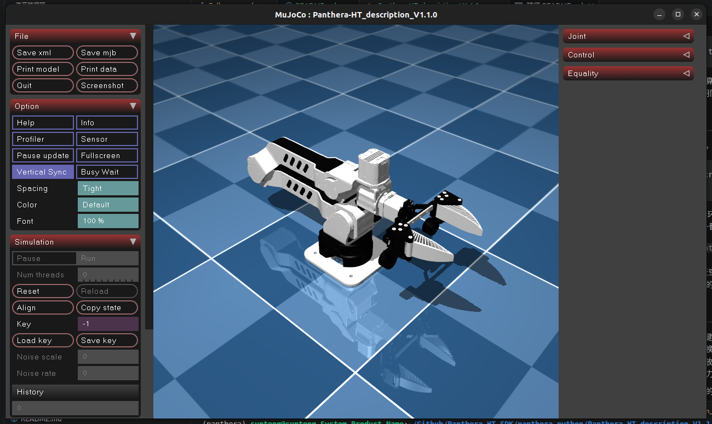

# Panthera-HT MuJoCo 力控预览



## 安装依赖

使用 Python 3，在终端安装所需库：

```bash
python -m pip install mujoco numpy trimesh Pillow
```

`mujoco` 用于仿真和可视化，`numpy` 用于数值计算，`trimesh` 用于网格转换，
`Pillow` 用于保存截图。安装和运行请使用同一个 Python 环境。

## 运行

从 `Panthera-HT_SDK` 仓库根目录进入 MuJoCo 目录，然后直接运行：

```bash
cd panthera_python/Panthera-HT_description_V1.1.0/mujoco
python visualize_mujoco.py
```

运行后会打开 MuJoCo 可视化窗口，需要桌面图形环境。如果系统只有 `python3`
命令，请将本文命令中的 `python` 统一替换为 `python3`。

程序从原 URDF 转换网格并生成 当前目录下的 `scene.xml`，不修改源 URDF。
场景沿用 Kinova7DoF-MuJoCo/Model/Kinova_System.xml 的棋盘格和天空。
灯光改为斜向聚光灯，保留环境补光和地面投影，减轻外壳及夹爪上的阴影条纹。

## 操作

- 双击选中可动连杆，然后按住 Ctrl + 鼠标右键拖动，施加外力。
- Ctrl + 鼠标左键拖动施加外力矩；Shift 可切换拖动方向。
- 普通鼠标左键旋转视角，右键平移，滚轮缩放。
- 空格暂停/继续，R 恢复初始姿态，G 开关重力补偿。

拖拽操作应在仿真运行时进行；暂停时原生查看器的扰动交互可能直接调整姿态。
查看器同步鼠标扰动的机制见 [MuJoCo Python 文档](https://mujoco.readthedocs.io/en/stable/python.html#passive-viewer)。

## 控制与模型

6 个关节均为 gear=1 的 motor，`data.ctrl` 单位为 N·m，限幅采用 URDF
的 effort（21、36、36、21、10、10）。`step()` 每步写入重力及科氏力偏置补偿，
关节被动阻尼为 1 N·m·s/rad，armature 为 0.01 kg·m²，无位置回正弹簧。
若需接自己的力矩控制器，修改 `step()` 中的 `data.ctrl` 赋值；界面 Control
滑块会被控制器覆盖。`--no-gravity-compensation` 可从零电机力矩启动。

基座固定，夹爪保持源 URDF 的固定连接。初始关节角为
`[0, 0, 0, 0, 0, 0]`，启动和 R 复位均使用 URDF 全零位。启用地面碰撞和关节限位；
因 STL 凸包会填满装配间隙，关闭机器人自碰撞。碰撞网格隐藏，保留原视觉配色。
生成的 XML 含 motor 和初始姿态 keyframe；重力补偿由本 Python 启动器执行。

## 验证与截图

```bash
python visualize_mujoco.py --check
MUJOCO_GL=egl python visualize_mujoco.py --screenshot preview.png
```

`--check` 检查模型加载、2 秒静止稳定性、末端 3 N 外力响应及撤力后的收敛。

## 文件结构

```text
Panthera-HT_description_V1.1.0/
├── urdf/                      # 原始 URDF 和 CSV 参数
├── meshes/
│   ├── stl/                   # 原始 STL 碰撞网格
│   └── visual/                # GLB 视觉网格
└── mujoco/
    ├── README.md
    ├── visualize_mujoco.py     # 转换、验证和可视化入口
    ├── scene.xml              # MuJoCo 场景
    ├── robot.urdf             # 转换中间文件
    ├── meshes/
    │   ├── obj/               # 运行脚本生成的 OBJ 网格
    │   └── stl/               # 保留的已有 STL 网格，当前脚本不使用
    ├── Panthera-HT_mujoco.png  # README 展示图片
    └── preview.png            # 渲染截图
```

修改机器人参数时，请编辑 `../urdf/` 中的原始 URDF。每次运行脚本会重新生成
`robot.urdf`、`scene.xml` 和 `meshes/obj/` 中的网格；这些生成文件不需要手动维护。
