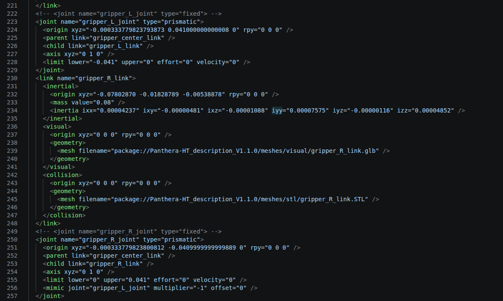
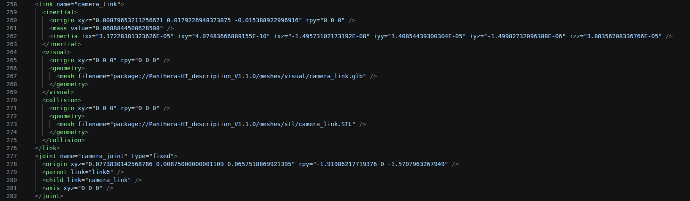
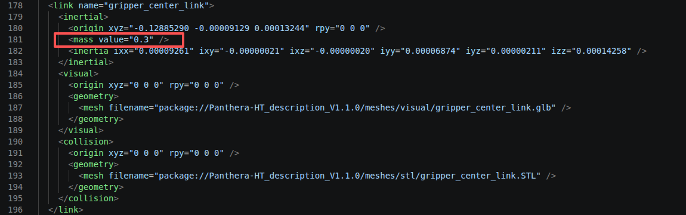

# URDF 配置说明

根据机械臂用途修改本目录中的 [Follower URDF](Panthera-HT_description_V1.1.0_follower.urdf) 或 [Leader URDF](Panthera-HT_description_V1.1.0_leader.urdf)，可以组合出以下配置：

| 配置 | 左右夹爪关节类型 | 相机部分 |
| --- | --- | --- |
| 固定夹爪 | `fixed` | 保持注释 |
| 可动夹爪 | `prismatic`，右侧 mimic 左侧 | 保持注释 |
| 固定夹爪 + D405 | `fixed` | 取消注释 |
| 可动夹爪 + D405 | `prismatic`，右侧 mimic 左侧 | 取消注释 |

两个源文件均采用固定夹爪，相机部分处于注释状态。以下操作直接修改实际使用的源 URDF，无需修改 `../mujoco/robot.urdf`；后者是脚本生成的中间文件。

## 启用夹爪自由度

左右夹爪需要同时切换为移动关节。每个关节的两行起始标签只能保留一行生效，内部参数和结尾的 `</joint>` 保持不变。

左夹爪原配置：

```xml
<joint name="gripper_L_joint" type="fixed">
<!-- <joint name="gripper_L_joint" type="prismatic"> -->
```

注释 `fixed` 行，取消 `prismatic` 行的注释：

```xml
<!-- <joint name="gripper_L_joint" type="fixed"> -->
<joint name="gripper_L_joint" type="prismatic">
```

右夹爪同样改为：

```xml
<!-- <joint name="gripper_R_joint" type="fixed"> -->
<joint name="gripper_R_joint" type="prismatic">
```

启用右夹爪关节内部已有的跟随配置；如果该行处于注释状态，移除该行外侧的 `<!--` 和 `-->`：

```xml
<mimic joint="gripper_L_joint" multiplier="-1" offset="0" />
```

修改后的完整示例如下：左右两处 `fixed` 行均已注释，`prismatic` 行生效，右夹爪保留 `mimic` 配置。



左右关节的轴均为 `0 1 0`，因此右侧位移取左侧的相反数，实现对称开合：

| 状态 | 左夹爪位移（m） | 右夹爪位移（m） |
| --- | --- | --- |
| 张开 | `0` | `0` |
| 闭合端点 | `-0.041` | `0.041` |

在支持 URDF mimic 的使用端，只需设置左夹爪关节位置，右侧按上述关系跟随。若要恢复固定夹爪，将左右两处 `fixed` 行取消注释，并重新注释 `prismatic` 行。

## 启用 D405 相机坐标系

找到文件末尾从 `camera_link` 到 `camera_joint` 的整块注释，同时启用相机连杆及其固定关节。

将开头：

```xml
<!-- <link name="camera_link">
```

改为：

```xml
<link name="camera_link">
```

将该块末尾、`</robot>` 前的：

```xml
</joint> -->
```

改为：

```xml
</joint>
```

保留块内的惯性、视觉、碰撞和关节参数。启用后，相机通过以下固定关节连接到 `link6`：

```xml
<joint name="camera_joint" type="fixed">
  <origin xyz="0.0773830142568786 0.00875000000001109 0.0657518869921395" rpy="-1.91986217719376 0 -1.5707963267949" />
  <parent link="link6" />
  <child link="camera_link" />
  <axis xyz="0 0 0" />
</joint>
```

`xyz` 单位为米，`rpy` 单位为弧度。这会启用文件中定义的 `camera_link` 坐标系及相机模型，不会启动相机驱动。若要禁用相机，在整个 `camera_link` 和 `camera_joint` 块外重新加上 `<!--` 与 `-->`。

取消整块注释后的示例如下，`camera_link` 和 `camera_joint` 应同时生效：



## 主臂与从臂的质量配置

主臂相比从臂，需要修改 `gripper_center_link` 的质量。用于主臂时，找到该连杆的 `<inertial>` 部分，将其中的 `<mass>` 设置为 `0.3`（单位：kg）：

```xml
<mass value="0.3" />
```

只修改 `gripper_center_link` 下的质量项，左右夹爪连杆的质量不随此步骤修改。从臂保留其对应的质量配置。

下图红框标出了主臂需要修改的位置：



## 修改后检查

保存文件并重新加载 URDF。可以在本目录运行以下命令，同时检查两个文件的 XML 格式：

```bash
python -c "import glob, xml.etree.ElementTree as ET; [ET.parse(path) for path in glob.glob('*.urdf')]; print('两个 URDF 的 XML 格式正确')"
```

此命令仅检查 XML 格式。夹爪运动与 mimic 跟随效果需要在实际使用的可视化或仿真工具中确认。
