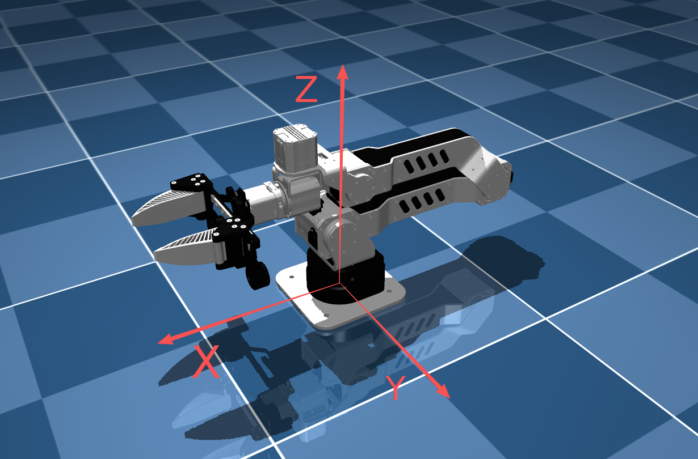
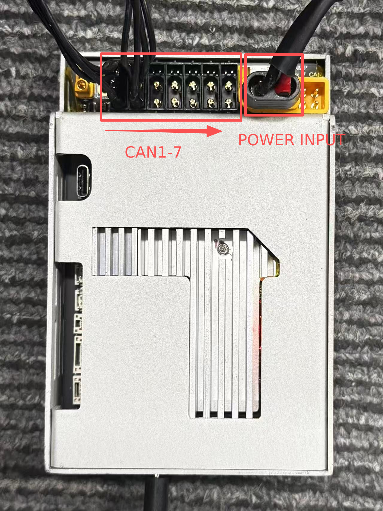
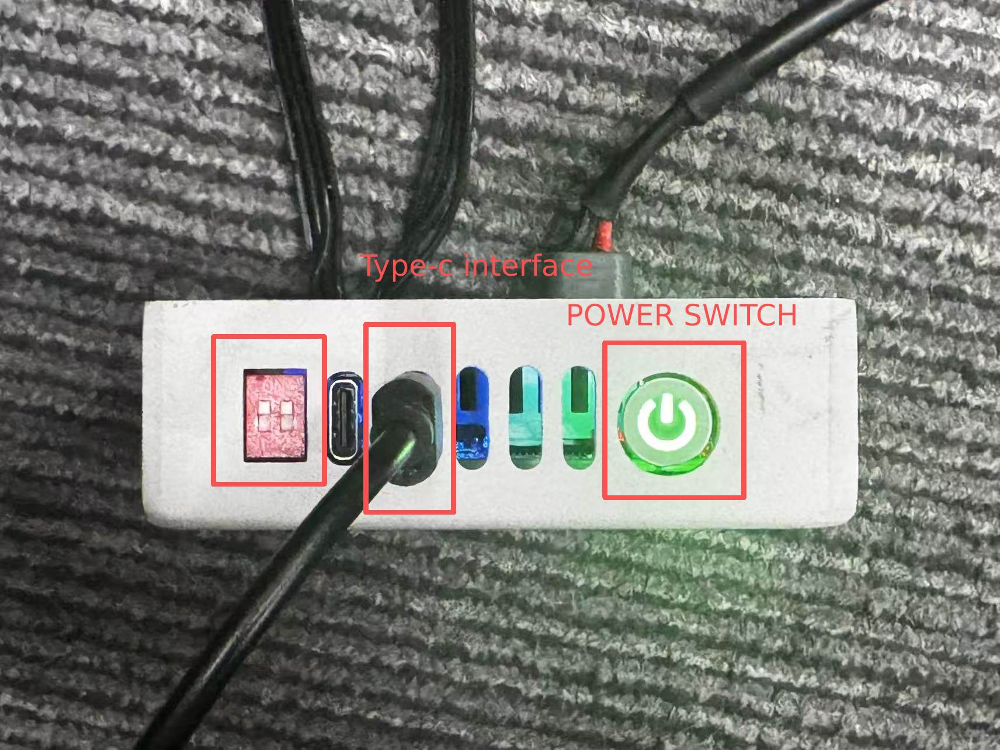

# Panthera 机械臂控制 Python SDK

[English](README_EN.md)

## 功能特性

- **多种控制模式**:
  - 位置速度控制（含最大力矩限制）
  - 五参数 MIT 模式控制（位置+速度+力矩+Kp+Kd）
  - 夹爪独立控制
- **运动学计算**:
  - 正运动学（FK）
  - 逆运动学（IK）
- **动力学计算**:
  - 重力补偿
  - 科氏力补偿
  - 质量矩阵
  - 摩擦力补偿
  - 完整动力学模型
- **轨迹规划**:
  - 七次多项式插值（速度、加速度、加加速度连续）
  - 带速度约束的七次多项式插值
- **安全功能**:
  - 关节位置限制
  - 力矩限制
  - 超时检测
  - 位置到达检测
- **主从协同控制**：支持双臂协同操作和轨迹记录回放
- **基于 YAML 的配置系统**

## 基座坐标系参考



## 环境安装

### 推荐：使用独立的 conda 环境

为避免与系统环境（如 ROS）冲突，强烈建议创建独立的 conda 环境：

```bash
# 创建新环境（支持 Python 3.9–3.12）
conda create -n panthera python=3.10
conda activate panthera
```

### 安装步骤

> **注意：** 方式1 中的 whl 包在 Ubuntu 22 下编译，若使用 Ubuntu 20 或其他系统出现兼容性问题，请使用方式2 从源码编译。

---

#### 方式1：使用预编译 whl 包（Ubuntu 22 推荐）

**步骤1：安装电机控制 SDK（whl 包）**

以下 whl 安装命令在 `panthera_python/` 目录执行，在 `motor_whl` 文件夹中选择对应 Python 版本的 whl 文件：

```bash
# Python 3.9
pip install motor_whl/hightorque_robot-1.2.0-cp39-cp39-linux_x86_64.whl

# Python 3.10
pip install motor_whl/hightorque_robot-1.2.0-cp310-cp310-linux_x86_64.whl

# Python 3.11
pip install motor_whl/hightorque_robot-1.2.0-cp311-cp311-linux_x86_64.whl

# Python 3.12
pip install motor_whl/hightorque_robot-1.2.0-cp312-cp312-linux_x86_64.whl
```

---

另外，`motor_whl/` 中也提供 aarch64 架构的 1.0.0 版本，支持 Python 3.9–3.12。请根据 `uname -m` 和 Python 版本选择，例如：

```bash
pip install motor_whl/hightorque_robot-1.0.0-cp310-cp310-linux_aarch64.whl
```

#### 方式2：从源码编译（Ubuntu 20 或其他系统）

以下命令均从 SDK 根目录执行，并且必须先激活目标 Conda 环境。

**步骤1：安装系统依赖**

```bash
sudo apt-get update
sudo apt-get install -y \
    build-essential \
    cmake \
    pkg-config \
    libglib2.0-dev \
    libyaml-cpp-dev \
    libserialport-dev
```

源码中已经包含 LCM 和串口库源码，因此不需要另外安装系统版 `liblcm-dev`；Python 编译使用当前已激活的 Conda 环境，不使用系统的 `python3-dev` 和 `python3-pip`。

**步骤2：安装 Python 编译依赖**

```bash
python -m pip install -U pip setuptools wheel pybind11
```

**步骤3：编译并安装电机 SDK C++ 项目（仅当前 Conda 环境）**

```bash
cmake -S panthera_cpp/motor_cpp -B panthera_cpp/motor_cpp/build \
    -DCMAKE_BUILD_TYPE=Release \
    -DCMAKE_INSTALL_PREFIX="$CONDA_PREFIX"
cmake --build panthera_cpp/motor_cpp/build -j"$(nproc)"
cmake --install panthera_cpp/motor_cpp/build
```

**步骤4：编译并安装 Python 绑定到当前 Conda 环境**

```bash
CMAKE_PREFIX_PATH="$CONDA_PREFIX" \
python -m pip install -e ./panthera_python --no-build-isolation --no-deps
```

这一步会调用 CMake 编译 `_hightorque_robot`，并将 `hightorque_robot` 以 editable package 安装到当前 Conda 环境。
不会修改 `/usr/local`，也不会影响其他虚拟环境中的 whl 安装。

---

**步骤2（方式1继续）/ 步骤5（方式2继续）：安装高层库依赖（使用 Panthera_lib 时需要）**

```bash
# 方法1：使用 requirements.txt（推荐，以下从 SDK 根目录执行）
cd panthera_python
python -m pip install -r requirements.txt
cd ..

# 方法2：手动安装
python -m pip install "numpy>=1.19.0,<2.0"
python -m pip install "pyyaml>=6.0"
python -m pip install "pin>=2.6.0"
python -m pip install "scipy>=1.9.0"
python -m pip install "osqp>=1.1.0,<2.0"
```

**重要提示：**
- ✅ 安装 `pin` 包（机器人动力学库），不是 `pinocchio`
- ⚠️ `pinocchio` 是一个测试框架，不是我们需要的包
- ✅ PyYAML 需要 6.0+ 版本才能支持 Python 3.12+
- ✅ 在 conda 环境中使用 `pip`，不要用 `pip3`

根据需要额外安装以下依赖；它们目前不在 `requirements.txt` 中：

| 功能 | 安装命令 |
| --- | --- |
| 轨迹 GUI、GUI 离线测试 | `python -m pip install PyQt5` |
| 绘图示例 | `python -m pip install matplotlib` |
| 键盘遥操作 | `python -m pip install pynput` |
| 北通/XInput 手柄 | `python -m pip install evdev` |
| GELLO、飞特舵机读取 | `python -m pip install feetech-servo-sdk` |

**步骤3（方式1）/ 步骤6（方式2）：验证安装**

手动验证：
```bash
python -c "import hightorque_robot; print('✓ 电机 SDK 安装成功')"
python -c "import pinocchio as pin; print('✓ pin 安装成功')"
python -c "import yaml; print('✓ pyyaml 安装成功')"
```

安装成功后，从 SDK 根目录进入 `scripts` 目录并验证导入：
```bash
# 注意：Panthera_lib 作为源码提供，需要在 scripts 目录下使用
cd panthera_python/scripts
python -c "from Panthera_lib import Panthera"
```

## 快速开始

### 通信板接线参考




### 赋串口权限
设备正常连接后可以查看串口设备；数量取决于所连接的通信板，不等于电机数量
```bash
ls /dev/ttyACM*
```
赋值权限：
```bash
sudo chmod -R 777 /dev/ttyACM*
```

### 测试示例
a. 首次打开先在 `panthera_python/scripts` 目录下运行 `0_robot_get_state.py` 脚本，查看各关节状态
```bash
python 0_robot_get_state.py
```
启动成功后会显示端口号、电机ID、和初始化电机的信息，随后循环打印各关节位置、速度等状态。

b. 运行位置速度控制程序
```bash
python 1_Joint_PosVel_control.py
```
机械臂会按指定速度运动到不同位置。若机械臂依次完成动作，则说明工作正常。

### 实现记录与播放轨迹
运行 `5_record_trajectory.py` 脚本，在单臂重力补偿下记录机械臂和夹爪的运动轨迹（当前使用 `Follower.yaml`）。记录完成后按 Ctrl+C 退出程序，轨迹文件会自动保存在 `scripts/trajectory/` 目录下（命名如 trajectory_20251211_160537.jsonl）。
```bash
python 5_record_trajectory.py
```
随后在 `5_replay_trajectory.py` 脚本内将 TRAJECTORY_FILE 改成刚刚保存好的轨迹文件名（从 `scripts/trajectory/` 读取），然后运行该脚本，从臂会自动运行记录好的轨迹。
```bash
python 5_replay_trajectory.py
```
若想使用主臂运行轨迹，则将该文件内的 config_path 变量中的 Follower.yaml 路径改成 Leader.yaml；录制时也应使用对应配置。

### 轨迹 GUI：记录、回放与拼接

在 `panthera_python/scripts/` 目录执行：

```bash
python 5_trajectory_gui.py
```

仅打开界面不会连接机械臂。当前默认配置为 `Follower.yaml`，可在脚本顶部的 `CONFIG_PATH` 修改。

1. 点击“启动重力补偿”，连接机械臂并进入可拖动示教状态。
2. 点击“开始记录（自动命名）”，拖动机械臂和夹爪；点击“停止记录并保存”结束录制，继续保持重力补偿。
3. 选择轨迹，设置回放次数或无限循环、回放间隔，点击“开始回放”。程序先从实际姿态过渡到轨迹起点。
4. “停止回放（保留重力补偿）”返回示教状态；“停止全部（进入阻尼）”结束当前控制。关闭窗口时也会执行阻尼和线程退出流程。

界面支持六关节曲线预览、轨迹重命名和删除。“拼接轨迹”可组合多个录制片段，插入停顿、过渡和回零动作，调整顺序并预览。设置的过渡时间不足时，会根据配置中的速度/加速度限制自动延长。

录制文件保存在 `scripts/trajectory/*.jsonl`。拼接保存时同时生成可回放的 `.jsonl` 和可重新编辑的 `.sequence.json` 配方；再次编辑配方需要保留它引用的原始轨迹文件。

GUI 回放全程使用 MIT 控制；命令行回放在到起点阶段使用位置速度控制，之后默认使用 MIT 回放。

### 主从遥操
将从臂连接至can口1,主臂连接至can口2
启动程序：
```bash
python 5_teleop_control.py
```
即可看到遥操效果

### GELLO 遥操

进入 `scripts` 目录，并指定 GELLO 串口启动遥操程序：

```bash
# 从 Panthera-HT_SDK/ 仓库根目录执行
cd panthera_python/scripts
python 7_gello_teleop.py --gello-port /dev/ttyACM1
```

如需先检查 GELLO 关节读取和映射而不连接 Panthera 从臂，可运行：

```bash
python 7_gello_teleop.py --gello-port /dev/ttyACM1 --dry-run
```

### 键盘与游戏手柄

在 `panthera_python/scripts/` 目录选择一个入口运行：

```bash
python 7_keyboard_cartesian_pos_control.py
python 7_keyboard_cartesian_vel_control.py
python 7_gamepad_cartesian_vel_control.py
```

前两者分别控制末端位姿和末端速度，按键映射见各脚本开头说明。游戏手柄入口使用 Linux `evdev`，默认设备为北通 A2P3A XInput；设备路径和速度参数位于脚本顶部，需具备对应 `/dev/input/` 设备的读取权限。

## 使用示例

### 基础控制示例

```python
from Panthera_lib import Panthera
import numpy as np

# 创建机械臂实例（默认使用 Follower 配置）
robot = Panthera()

# 或指定配置文件
# robot = Panthera("../robot_param/Leader.yaml")

# 获取当前关节角度
joint_pos = robot.get_current_pos()
print(f"当前关节角度: {joint_pos}")

# 位置速度控制（6个关节）
target_pos = [0.0, 0.5, 0.5, 0.0, 0.5, 0.0]
target_vel = [0.5, 0.5, 0.5, 0.5, 0.5, 0.5]
max_torque = [10.0, 10.0, 10.0, 5.0, 5.0, 5.0]

# 发送控制命令（单关节位置速度控制）
robot.Joint_Pos_Vel(target_pos, target_vel, max_torque)

# 等待到达目标位置
robot.Joint_Pos_Vel(target_pos, target_vel, max_torque,
                    iswait=True, tolerance=0.01, timeout=15.0)

# 夹爪控制
robot.gripper_open()  # 打开夹爪
# robot.gripper_close(pos=0.0)  # 关闭夹爪
```

## API 参考

### Panthera 类

Panthera 类继承自 `htr.Robot`，提供了机械臂级别的控制接口。

#### 初始化
- `Panthera(config_path=None)` - 创建机械臂实例
  - `config_path`: 配置文件路径，默认使用 Follower.yaml

`robot.gripper_installed` 是必填项。在实际机械臂没有夹爪时，将所用的 `Follower.yaml` 或 `Leader.yaml` 修改为：

```yaml
robot:
  gripper_installed: false
  gripper_name: "gripper"
```

设置为 `false` 后，底层 SDK 只初始化六个机械臂关节，不再探测第七个夹爪电机；动力学模型会删除 `urdf.end_effector_link` 本身及其全部后代，并使用 `urdf.end_effector_link_without_gripper` 作为控制末端。相机等挂在 `end_effector_link` 父连杆上的并列分支会保留。因此重力补偿、FK、IK、MoveL 和 VR 笛卡尔控制都会使用无夹爪模型，不需要修改原始 URDF 或 `motor_param` 中的 `motor_num`。实机安装夹爪时设置为 `true`。

如果自定义 URDF 已经手动删除 `end_effector_link`，无夹爪模式也可以直接加载；程序会继续清理引用该名称的残留 joint 和后代。`end_effector_link_without_gripper` 对应的 link 必须保留。

```yaml
urdf:
  end_effector_link: "gripper_center_link"
  end_effector_link_without_gripper: "link6"
```

夹爪配置只从 YAML 读取，修改后需要重新启动程序。运行后可通过 `robot.has_gripper` 判断夹爪是否可用；无夹爪时，夹爪控制接口返回 `False`，夹爪状态接口返回 `available=False` 的零值占位状态。

#### 状态获取
- `get_current_state()` - 获取所有关节状态列表
- `get_current_pos()` - 获取当前关节角度 (np.ndarray [6,])
- `get_current_vel()` - 获取当前关节速度 (np.ndarray [6,])
- `get_current_torque()` - 获取当前关节力矩 (np.ndarray [6,])
- `get_current_state_gripper()` - 获取夹爪状态
- `get_current_pos_gripper()` - 获取夹爪位置
- `get_current_vel_gripper()` - 获取夹爪速度
- `get_current_torque_gripper()` - 获取夹爪力矩

#### 控制命令
- `Joint_Pos_Vel(pos, vel, max_tqu=None, iswait=False, tolerance=0.1, timeout=15.0)`
  - 单关节位置速度最大力矩控制（每个关节独立设置）
  - `pos`: 目标位置数组 [6,] (rad)
  - `vel`: 目标速度数组 [6,] (rad/s)
  - `max_tqu`: 最大力矩数组 [6,] (Nm)，为None时使用配置文件中的默认值
  - `iswait`: 是否等待到达目标
  - `tolerance`: 位置容差 (rad)
  - `timeout`: 超时时间 (s)

- `moveJ(pos, duration, max_tqu=None, iswait=False, tolerance=0.1, timeout=15.0)`
  - 关节空间运动控制（所有关节同步到达目标位置）
  - `pos`: 目标位置数组 [6,] (rad)
  - `duration`: 运动时间 (s)
  - `max_tqu`: 最大力矩数组 [6,] (Nm)，为 None 时使用配置文件中的默认值
  - `iswait`: 是否等待到达目标
  - `tolerance`: 位置容差 (rad)
  - `timeout`: 超时时间 (s)

- `pos_vel_tqe_kp_kd(pos, vel, tqe, kp, kd)`
  - 五参数MIT控制模式
  - `pos`: 目标位置 [6,] (rad)
  - `vel`: 目标速度 [6,] (rad/s)
  - `tqe`: 前馈力矩 [6,] (Nm)
  - `kp`: 位置增益 [6,]
  - `kd`: 速度增益 [6,]

- `gripper_control(pos, vel, max_tqu)` - 夹爪位置速度控制
- `gripper_control_MIT(pos, vel, tqe, kp, kd, send=True)` - 夹爪MIT控制；`send=False` 仅缓存指令，供后续机械臂命令统一发送
- `gripper_open(pos=1.6, vel=0.5, max_tqu=0.5)` - 打开夹爪
- `gripper_close(pos=0.0, vel=0.5, max_tqu=0.5)` - 关闭夹爪

- `Joint_Vel(vel)` - 六关节速度控制
- `moveL(target_position, target_rotation=None, duration=None, use_spline=True, max_tqu=None)` - 笛卡尔直线运动
- `set_brake()` - 全部电机（含夹爪）进入固件阻尼模式

#### 位置检测
- `check_position_reached(target_positions, tolerance=0.1)` - 检查是否到达目标
- `wait_for_position(target_positions, tolerance=0.01, timeout=15.0)` - 等待到达目标

#### 运动学
- `forward_kinematics(joint_angles=None)` - 正运动学
  - 返回: `{'position': [x,y,z], 'rotation': R, 'transform': T, 'joint_angles': q}`

- `inverse_kinematics(target_position, target_rotation=None, init_q=None, max_iter=1000, eps=1e-3, damping=1e-2, adaptive_damping=True, multi_init=True, num_attempts=8)` - 逆运动学
  - `target_position`: 目标位置 [x, y, z] (m)
  - `target_rotation`: 目标旋转矩阵 3x3 (可选)
  - `init_q`: 初始关节角度 (可选)
  - 返回: 关节角度解 [6,] 或 None

#### 动力学
- `get_Gravity(q=None)` - 重力补偿力矩 G(q)
- `get_Coriolis(q=None, v=None)` - 科氏力矩阵 C(q,v)
- `get_Coriolis_vector(q=None, v=None)` - 科氏力向量 C(q,v)*v
- `get_Mass_Matrix(q=None)` - 质量矩阵 M(q)
- `get_Inertia_Terms(q=None, a=None)` - 惯性力矩 M(q)*a
- `get_Dynamics(q=None, v=None, a=None)` - 完整动力学 τ = M(q)a + C(q,v)v + G(q)
- `get_friction_compensation(vel=None, Fc=None, Fv=None, vel_threshold=0.01)` - 摩擦力补偿
  - 摩擦模型: τ_friction = Fc * sign(vel) + Fv * vel

#### 轨迹规划
- `septic_interpolation(start_pos, end_pos, duration, current_time)`
  - 七次多项式插值（速度、加速度、加加速度连续）
  - 返回: (位置, 速度, 加速度)

- `septic_interpolation_with_velocity(start_pos, end_pos, start_vel, end_vel, duration, current_time)`
  - 带速度约束的七次多项式插值
  - 返回: (位置, 速度, 加速度)

#### 继承的基础方法
- `motor_send_cmd()` - 发送控制命令到电机
- `send_get_motor_state_cmd()` - 请求电机状态
- `set_stop()` - 停止所有电机
- `set_reset()` - 重启所有电机
- `set_timeout(timeout_ms)` - 设置超时时间

### 电机参数配置 (motor_param/*.yaml)
包含电机ID、CAN总线配置、电机型号等底层参数。

## 项目结构

```
panthera_python/
├── motor_whl/                  # 预编译whl包
│   ├── hightorque_robot-1.2.0-cp39-cp39-linux_x86_64.whl
│   ├── hightorque_robot-1.2.0-cp310-cp310-linux_x86_64.whl
│   ├── hightorque_robot-1.2.0-cp311-cp311-linux_x86_64.whl
│   ├── hightorque_robot-1.2.0-cp312-cp312-linux_x86_64.whl
│   └── hightorque_robot-1.0.0-*-linux_aarch64.whl # cp39/cp310/cp311/cp312
│
├── Panthera-HT_description_V1.1.0/ # 机械臂模型与仿真资源
│   ├── urdf/                   # Leader/Follower URDF及配置说明
│   ├── meshes/                 # GLB外观与STL碰撞网格
│   ├── mujoco/                 # MuJoCo场景、网格和可视化脚本
│   ├── image/                  # URDF配置说明图片
│   ├── config/                 # 关节名称配置
│   └── launch/                 # ROS启动文件
│
├── robot_param/                # 机械臂配置文件
│   ├── Leader.yaml             # 主臂配置
│   ├── Follower.yaml           # 从臂配置
│   └── motor_param/            # 电机参数
│       ├── 6dof_Panthera_params_leader.yaml
│       ├── 6dof_Panthera_params_follower.yaml
│       ├── motor_1.yaml
│       ├── motor_6.yaml
│       └── robot_config.yaml
│
├── scripts/                    # 控制脚本
│   ├── Panthera_lib/           # 高层封装库
│   │   ├── Panthera.py         # Panthera类定义
│   │   ├── qp_ik.py            # Pinocchio + OSQP 速度级逆运动学
│   │   ├── recorder.py         # 轨迹记录工具
│   │   └── __init__.py         # 模块初始化
│   │
│   ├── 0_feetech_get_joint_positions.py # GELLO 七个飞特舵机位置读取与通信检查
│   ├── 0_robot_get_state.py    # 状态查看
│   ├── 0_robot_set_zero.py     # 设置零位
│   │
│   ├── 1_Joint_PosVel_control.py           # 单关节位置速度控制
│   ├── 1_Joint_Vel_control.py              # 速度控制
│   ├── 1_Joint_PD_control.py               # PD控制
│   ├── 1_moveJ_control.py                  # 关节空间运动控制 (moveJ)
│   ├── 1_forward_kinematics_test.py        # 正运动学测试
│   ├── 1_inverse_kinematics_test.py        # 逆运动学测试
│   │
│   ├── 2_inv_PosVel_control.py             # 基于逆运动学的位置控制
│   ├── 2_gravity_compensation_control.py   # 重力补偿控制
│   ├── 2_gravity_friction_compensation_control.py  # 重力摩擦力补偿控制
│   ├── 2_Jointimpendence_control_with_gra_pd.py    # 关节阻抗控制(重力+PD)
│   ├── 2_Jointimpendence_control_with_gra_fri_pd.py # 关节阻抗控制(重力+摩擦力+PD)
│   │
│   ├── 3_interpolation_control_zeroVel.py   # 插值轨迹控制(零速度)
│   ├── 3_interpolation_control_nozeroVel.py # 插值轨迹控制(非零速度)
│   ├── 3_sin_trajectory_control.py          # 正弦轨迹控制
│   ├── 3_sin_trajectory_control_with_plot.py # 正弦轨迹及绘图
│   ├── 3_gravity_compensation_with_fk.py    # 重力补偿+正运动学
│   │
│   ├── 4_impedance_trajectory_control_with_gra_pd.py  # 基于轨迹的阻抗控制
│   │
│   ├── 5_teleop_control.py     # 主从臂遥操作
│   ├── 5_record_trajectory.py  # 轨迹记录
│   ├── 5_replay_trajectory.py  # 轨迹回放
│   ├── 5_trajectory_gui.py     # 轨迹录制、循环回放与拼接界面
│   ├── trajectory/            # 录制与拼接文件（运行时生成）
│   │
│   ├── 6_moveL_pos_control.py  # 笛卡尔空间直线运动控制
│   ├── 6_moveL_rotate_control.py # 笛卡尔空间旋转运动控制
│   │
│   ├── 7_gamepad_cartesian_vel_control.py   # 北通/XInput 手柄末端速度控制
│   ├── 7_gello_teleop.py                    # GELLO 遥操作 Panthera 从臂（MIT位置跟随）
│   ├── 7_keyboard_cartesian_pos_control.py  # 键盘控制笛卡尔空间位姿（IK求解）
│   ├── 7_keyboard_cartesian_vel_control.py  # 键盘控制末端速度（雅可比矩阵）
│   ├── 7_vr_cartesian_control.py            # Quest VR单臂笛卡尔空间遥操作
│   ├── 7_vr_dual_cartesian_control.py       # Quest VR双臂笛卡尔空间遥操作
│   ├── 7_vr_usb_start_quickly.py             # USB快速启动Quest数据转发和VR遥操
│   ├── Quest_controller_stream/            # 内置 Quest 手柄数据转发服务及使用说明
│   │
│   ├── tests/                 # 不连接硬件的自动化测试
│   │   ├── test_optional_gripper.py
│   │   ├── test_trajectory_gui.py
│   │   └── test_vr_qp.py
│   └── motor_example/          # 底层电机控制示例
│       ├── 01_motor_get_status.py
│       ├── 02_position_control.py
│       ├── 03_velocity_control.py
│       ├── 04_torque_control.py
│       ├── 05_voltage_control.py
│       ├── 06_current_control.py
│       ├── 07_pos_vel_maxtorque_control.py
│       ├── 08_pos_vel_torque_kp_kd_control.py
│       ├── 09_set_zero.py
│       ├── motor_control.py
│       └── motor_README.md
│
├── hightorque_robot/           # 底层绑定的 Python 包入口
├── src/bindings.cpp            # pybind11 绑定源码
├── CMakeLists.txt              # Python 扩展构建配置
├── images/                     # 图片资源
├── requirements.txt            # Python依赖
├── setup.py                    # 安装脚本
├── pyproject.toml              # 项目配置
└── README.md                   # 本文档
```

## Quest VR 遥操

### 先了解三个程序的作用

VR 遥操的数据链路如下：

```text
Quest Browser / 手柄
        │ WebSocket
        ▼
Quest_controller_stream          只转发数据，不控制机械臂
        │ UDP 127.0.0.1:5005
        ▼
单臂或双臂遥操接收脚本           解算 QP，并向机械臂发送 MIT 指令
        │
        ▼
Panthera 机械臂
```

| 程序 | 功能 | 是否控制机械臂 |
|---|---|---|
| `Quest_controller_stream/start_stream_server.py` | 提供 Quest 网页，将 WebSocket 手柄数据转发到 UDP 5005 | 否 |
| `Quest_controller_stream/quest_stream_ui.py` | 上述转发服务的桌面调试界面，可查看和验证手柄数据 | 否 |
| `7_vr_cartesian_control.py` | 接收 UDP 数据，使用右手柄控制一台 `Follower` | 是，单臂 |
| `7_vr_dual_cartesian_control.py` | 接收 UDP 数据，左手柄控制 `Leader`，右手柄控制 `Follower` | 是，双臂 |
| `7_vr_usb_start_quickly.py` | 通过 USB 自动启动转发服务，并从单臂、双臂接收脚本中选择一个启动 | 间接控制，推荐入口 |

**USB 遥操推荐只运行 `7_vr_usb_start_quickly.py`。使用快速启动脚本时，不要再单独运行 `Quest_controller_stream`、单臂脚本或双臂脚本，否则会产生端口占用或重复控制。**

### 启动前准备

安装 Python 依赖：

```bash
python -m pip install -r panthera_python/requirements.txt
python -m pip install websockets
```

一键启动只支持 USB，需要安装 `adb`。手动使用 WiFi 转发时，还需要 `openssl` 生成本地证书：

```bash
sudo apt install adb openssl
```

USB 使用前连接 Quest，允许头显中的 USB 调试授权，并确认：

```bash
adb devices
```

设备状态应显示为 `device`，不能是 `unauthorized`。

### 方式一：USB 快速启动（推荐）

从 SDK 根目录进入脚本目录：

```bash
cd panthera_python/scripts
```

`7_vr_usb_start_quickly.py` 只使用 USB 有线连接，并同时启动 Quest 数据转发和机械臂遥操。根据机械臂数量选择一条命令：

| 使用方式 | 启动命令 |
|---|---|
| USB + 单臂 | `python 7_vr_usb_start_quickly.py` |
| USB + 双臂 | `python 7_vr_usb_start_quickly.py --controller dual` |

单臂模式使用右手柄控制 `Follower.yaml` 对应的机械臂。双臂模式使用左手柄控制 `Leader.yaml`、右手柄控制 `Follower.yaml`。

#### 快速启动步骤

1. 用 USB 连接 Quest，确认 `adb devices` 能看到设备。
2. 运行上表中的 USB 单臂或双臂命令。
3. 启动器自动配置 `adb reverse`、启动数据转发服务，并在 Quest Browser 打开 `http://localhost:8080` 页面。
4. 在头显网页中点击 `Start XR Stream`。
5. 等待终端显示已收到 Quest 数据和机械臂初始化完成，再按住手柄 `Squeeze` 开始控制。

启动时会关闭 Quest Browser 中遗留的旧 WebVR 会话和标签页，确保页面使用 USB 的 `localhost + adb reverse` 链路。

其他启动选项：

```bash
# USB 模式不自动打开 Quest Browser
python 7_vr_usb_start_quickly.py --no-open-quest

# 只显示将要执行的命令，不连接设备
python 7_vr_usb_start_quickly.py --dry-run
```

按一次 `Ctrl+C` 后，启动器会停止数据转发、通过 ADB 自动关闭 Quest Browser 页面和 WebXR 会话，并等待机械臂完成回零。回零完成前不要关闭终端或切断机械臂电源。回零期间重复按 `Ctrl+C` 不会跳过安全退出流程。

Quest Browser 页面本身不占用电脑的 `8080/8765` 端口，占用端口的是数据转发进程；快速启动脚本退出时会同时回收该进程。使用 `--no-open-quest` 时，启动器不会自动打开或关闭 Quest Browser。需要 WiFi 时，请使用下面的分步调试方式。

### 方式二：分步启动（仅用于调试）

分步启动需要两个终端：终端 1 只运行数据转发，终端 2 只运行一个遥操接收脚本。**不要同时运行 USB 快速启动脚本。**

#### 终端 1：启动数据转发

```bash
cd panthera_python/scripts/Quest_controller_stream

# USB 转发
python start_stream_server.py --adb always --udp-ip 127.0.0.1 --udp-port 5005

# WiFi 转发（与上一条二选一）
python start_stream_server.py --adb never --udp-ip 127.0.0.1 --udp-port 5005
```

也可以运行 `python quest_stream_ui.py` 使用桌面界面；桌面 UI 和 `start_stream_server.py` 仍然只能二选一。完整说明见 [Quest Controller Stream 使用说明](scripts/Quest_controller_stream/README.md)。

在 Quest Browser 打开终端或 UI 显示的对应地址，并点击 `Start XR Stream`。如果使用过 UI 的 `Start Verify` 或 `udp_receiver_test.py`，启动机械臂控制前必须停止验证，释放 UDP 5005。

#### 终端 2：启动一个遥操接收脚本

```bash
cd panthera_python/scripts

# 单臂：右手柄控制 Follower
python 7_vr_cartesian_control.py

# 双臂：左手柄控制 Leader，右手柄控制 Follower（与上一条二选一）
python 7_vr_dual_cartesian_control.py
```

### 手柄操作与控制方式

- 按住对应手柄的 `Squeeze`：激活控制；单臂使用右手柄，双臂使用左右手柄。
- 移动手柄：控制机械臂末端位置。
- 旋转手柄：控制机械臂末端姿态。
- 按住 `Squeeze` 并按下 `Trigger`：控制对应夹爪。
- 松开 `Squeeze`：停止运动并保持当前位置。

单臂和双臂脚本均监听本机 `UDP 5005`，使用 `Panthera_lib/qp_ik.py` 的速度级 QP（OSQP）生成连续关节位置目标，并通过 MIT 模式控制机械臂。单臂和双臂遥操均不保存轨迹 CSV，也不生成或弹出曲线图。启动时机械臂会移动到预设姿态，正常退出时会尝试回零。

当前 VR 参数位于两个控制脚本顶部的 `VR_MAX_*`。关节速度上限为 `[3, 3, 3, 3, 4, 4] rad/s`，关节位置限位保持生效。离线测试只能验证软件逻辑，不能代替实机方向和跟踪性能验证。

## 离线测试

从仓库根目录执行：

```bash
cd panthera_python

# 轨迹 GUI：依赖 NumPy、PyYAML、PyQt5
QT_QPA_PLATFORM=offscreen python -m unittest discover -s scripts/tests -p 'test_trajectory_gui.py' -v

# VR/QP：依赖 requirements.txt 中的高层库依赖
python -m unittest discover -s scripts/tests -p 'test_vr_qp.py' -v

# 可选夹爪：使用模拟底层 SDK，不连接硬件
python -m unittest discover -s scripts/tests -p 'test_optional_gripper.py' -v
```

- `test_trajectory_gui.py`：使用模拟机器人和临时轨迹目录，检查插值、回放时序、循环/取消、拼接配方、关节限位、七电机完整指令和关闭流程。
- `test_vr_qp.py`：替换原生电机 SDK，检查 QP 求解和 VR 控制集成逻辑。
- `test_optional_gripper.py`：替换底层电机 SDK，检查六/七电机配置、夹爪缺失处理和无夹爪动力学模型裁剪。

这三组测试不连接硬件；GUI 测试以无窗口模式运行。它们验证软件逻辑，不验证实机运动效果。`scripts/1_forward_kinematics_test.py` 等普通示例仍会创建机器人实例，不属于上述离线测试。

## 故障排除

### URDF加载失败
检查配置文件中的URDF路径是否正确，确保相对路径从配置文件所在目录计算。

### 逆运动学不收敛
检查目标位置是否在机械臂工作空间内，可以调整 `max_iter` 和 `eps` 参数。

### 电机无法连接
检查板子开关情况，电机电源按钮亮绿灯则为上电
若依旧无法连接请检查电机之间连接线情况

### 7_vr_cartesian_control.py 无法收到手柄数据

检查内置的 `scripts/Quest_controller_stream` 是否已经启动，并确认以下项目一致：

- `Quest_controller_stream` 的 `UDP IP` 为 `127.0.0.1`
- `Quest_controller_stream` 的 `UDP Port` 为 `5005`
- `7_vr_cartesian_control.py` 正在本机运行
- Quest Browser 页面中已经点击 `Start XR Stream`
- 若使用 USB 模式，`adb devices` 能看到 Quest 设备
- 若使用 WiFi 模式，Quest 与电脑处于同一局域网，且已接受 HTTPS 证书警告


## 小技巧
自动赋值串口权限
a.修改udev规则文件：
```bash
sudo gedit /etc/udev/rules.d/99-tegra-devices.rules
```
b.添加如下内容，并保存：
```bash
KERNEL=="ttyACM*", MODE="0777"
```
c.
重新加载udev规则：
```bash
sudo udevadm control --reload-rules
```
重新连接电脑和主板即可生效。


## 常见问题
1.libserialport.so.0缺失
更新包列表
sudo apt-get update

安装 libserialport 开发库
sudo apt-get install libserialport-dev

检查安装的文件
dpkg -L libserialport-dev | grep "\.so"

2.导入hightorque_robot失败: libyaml-cpp.so.0.6: cannot open shared object file: No such file or directory
请确保已安装hightorque_robot whl包
安装方法: pip install hightorque_robot-*.whl
 # 检查库文件是否正确安装
ls -la /usr/local/lib/libyaml-cpp*

若当前库为 0.7，而 wheel 需要 0.6，说明动态库版本不匹配。优先使用前文源码编译方式，让 SDK 匹配本机依赖，无需删除现有库。

依赖 yaml-cpp 0.6 的旧 wheel 不适用于当前系统库时，请改用与当前 Python/架构匹配的 wheel，或按前文说明从 `Panthera-HT_SDK/` 仓库源码编译 SDK。不要通过删除或覆盖系统现有 yaml-cpp 库来兼容旧 wheel。

更新库缓存
sudo ldconfig


## 许可证

MIT License

## 贡献

欢迎提交Issue和Pull Request!

## 联系方式

如有问题，请提交Issue或联系维护者。
