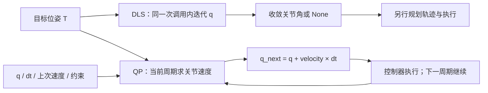
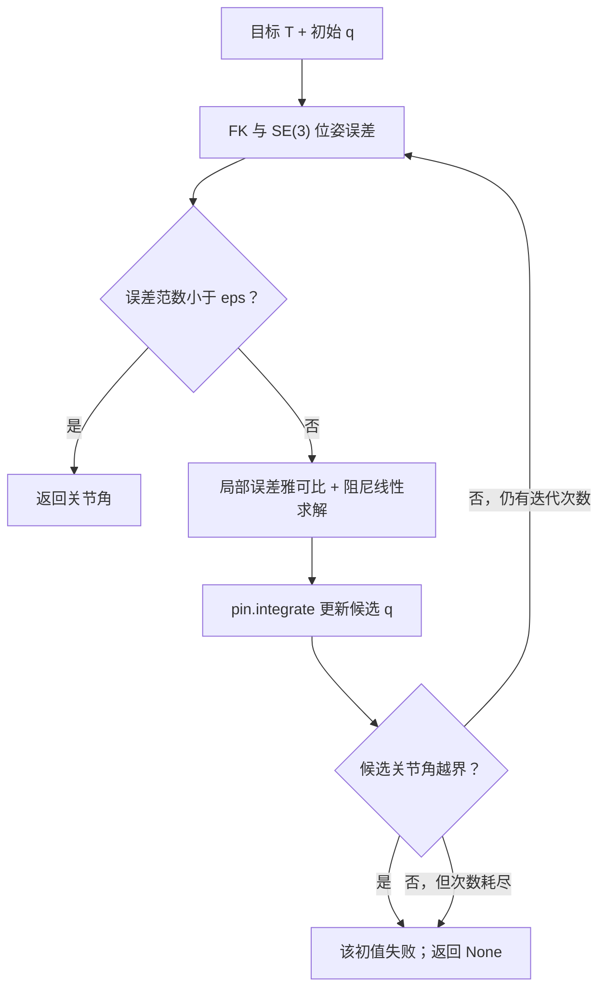
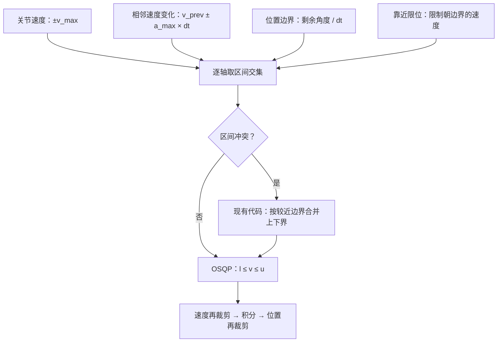

# Panthera：DLS 迭代逆解与 QP 逆运动学

[English](README_IK_QP_EN.md) · [SDK 总说明](../README.md)

**适用范围：本目录当前六轴 Panthera SDK，代码核对日期 2026-10-16。** 
## 1. 先看区别

DLS 通常在一次函数调用中反复更新关节角，尝试得到目标位姿的解；这里的 QP 每个控制周期求一个关节速度，再积分出下一步关节角。**QP 也是数值方法，OSQP 内部也有迭代；不能把它理解为解析逆解。**

| 项目 | 当前 DLS 迭代 IK | 当前速度级 QP IK |
|---|---|---|
| 接口 | `robot.inverse_kinematics(...)` | `solver.step(q, T, dt, ...)` |
| 输出 | 目标关节角 `ndarray`，失败为 `None` | `QPIKResult`：下一步关节角、速度、误差、状态 |
| 每次调用的含义 | 尝试把位姿误差收敛到阈值 | 求当前周期最合适的局部运动 |
| 关节限位 | 迭代候选越界即放弃该初值 | 把位置边界换成速度边界，并在边界附近减速 |
| 速度／加速度 | 内部数值步长控制，不是实际控制周期的约束 | 约束命令速度及相邻命令速度变化；冲突处理见第 6 节 |
| 状态 | 单初值或多个初值尝试 | 每只臂保留各自的 `previous_velocity` |
| 适合的调用方式 | 单次目标、离线可达性检查、路径点求解 | 连续手柄目标、小步笛卡尔跟踪 |
| 不保证的事情 | 全局找到所有解、轨迹连续、无碰撞 | 单步到达目标、全局可达、无碰撞或真实力矩限制 |



图 1：上支路的“迭代次数”属于一次求解；下支路的“控制周期”对应持续跟踪。两者都需要外部控制与反馈。

## 2. 源码入口、单位和坐标系

| 文件 | 关注的函数／变量 |
|---|---|
| [Panthera_lib/Panthera.py](Panthera_lib/Panthera.py) | `inverse_kinematics`、`_inverse_kinematics_dls_single_impl`、`_inverse_kinematics_dls_multi_init_impl`、`forward_kinematics`、`get_jacobian` |
| [Panthera_lib/qp_ik.py](Panthera_lib/qp_ik.py) | `PinocchioOSQPIK.__init__`、`_velocity_bounds`、`step`、`reset`、`QPIKResult` |
| [单臂 VR](7_vr_cartesian_control.py) | `main` 中构造 `qp_solver` 并调用 `step` |
| [双臂 VR](7_vr_dual_cartesian_control.py) | `create_arm_state`、`process_arm_control`、`sync_targets_to_current_state` |
| [Follower.yaml](../robot_param/Follower.yaml) / [Leader.yaml](../robot_param/Leader.yaml) | `joint_limits`、`velocity_limits`、`acceleration_limits`、`end_effector_link` |
| [离线回归](tests/test_vr_qp.py) | URDF 收敛、双臂独立性、重复包、失效处理与夹爪发送 |

- 关节角：rad；关节速度：rad/s；关节加速度：rad/s²；位置：m；时间：s。
- `T` 是 4×4 齐次变换：左上 3×3 为旋转矩阵，右上 3×1 为位置。目标与 FK 都在所选 URDF 的模型基座坐标系中。
- QP 的雅可比来自 `pin.LOCAL_WORLD_ALIGNED`：线速度／角速度用基座方向表示，作用点是配置中的末端 frame。`feedforward_twist = [vx, vy, vz, wx, wy, wz]`，单位 m/s、rad/s。
- 当前 `Leader.yaml` 的末端为 `joint6`，`Follower.yaml` 为 `tool_link`。不要把两者的 TCP 位姿直接混用。
- 六个关节的顺序是 `joint1 ... joint6`；夹爪独立，不是第七个 IK 自由度。

## 3. DLS 怎么调用、内部怎么迭代



图 2：多初值模式在外层依次换起点，并不改变这条单初值求解流程。某次失败不等于已经证明目标不可达。

常见 DLS 表达式是 `Δq = Jᵀ(JJᵀ + λ²I)⁻¹e`。本实现使用 `pin.log(current⁻¹ × target)` 的六维误差、`Jlog6` 修正和负号一致的下降方向，再以内部步长 `0.1` 积分。这个 `0.1` 不是电机循环周期；内部向量范数上限 `10.0` 也不是逐轴硬件限速。

| 参数 | 默认值 | 当前实现的含义 |
|---|---|---|
| `target_position` | 必填 | 长度为 3 的基座坐标位置 |
| `target_rotation` | `None` | **当前 `None` 被替换为 `np.eye(3)`，仍要求姿态对齐单位矩阵** |
| `init_q` | `None` | 单初值模式下缺省读当前关节角 |
| `multi_init` | `True` | 当前反馈、零位、中位、随机初值；此分支不使用传入的 `init_q` |
| `num_attempts` | `8` | 多初值最多尝试次数 |
| `max_iter` | `1000` | 每个初值的最大迭代次数 |
| `eps` | `1e-3` | 六维 SE(3) 误差范数阈值，不能只解释为 1 mm |
| `damping` | `1e-2` | DLS 阻尼 λ 的基值，在矩阵中以 λ² 出现 |
| `adaptive_damping` | `True` | λ 随误差变化：`λ_base × (1 + 1/(norm(error)+0.1))` |

**纠正一处现有注释：** `target_rotation=None` 在函数注释中写为“只考虑位置”，与代码不一致。若想保持当前姿态，显式传入当前 FK 的旋转矩阵；若想真正忽略姿态，需修改 DLS 的误差／雅可比任务行，或使用第 7 节的 QP 零姿态权重示例。本说明不修改求解器。

### 3.1 可运行的离线模型准备

在已安装 SDK 依赖的 `panthera` 环境中，从本 `scripts` 目录运行。下面的模型适配器只借用 SDK 数学方法，**不创建 `Panthera()` 或底层 `Robot()`，不连接电机**。导入 `Panthera_lib` 仍要求已安装 `hightorque_robot` 包。将下面的准备代码与 3.2／4.1 的代码放在同一个 Python 会话或文件中。

```python
from pathlib import Path
import numpy as np
import pinocchio as pin
import yaml
from Panthera_lib import Panthera
from Panthera_lib.qp_ik import PinocchioOSQPIK


class ModelOnly:
    # Reuse SDK math methods without inheriting or constructing hightorque_robot.Robot.
    forward_kinematics = Panthera.forward_kinematics
    get_jacobian = Panthera.get_jacobian
    inverse_kinematics = Panthera.inverse_kinematics
    _inverse_kinematics_dls_single_impl = Panthera._inverse_kinematics_dls_single_impl
    _inverse_kinematics_dls_multi_init_impl = Panthera._inverse_kinematics_dls_multi_init_impl

    def __init__(self, config_name="Follower.yaml"):
        path = Path("../robot_param") / config_name  # Run from scripts/.
        cfg = yaml.safe_load(path.read_text())
        self.model = pin.buildModelFromUrdf(str(path.parent / cfg["urdf"]["file_path"]))
        self.data = self.model.createData()
        self.joint_names = cfg["kinematics"]["joint_names"]
        self.motor_count = len(self.joint_names)
        self.end_effector_frame_id = self.model.getFrameId(cfg["urdf"]["end_effector_link"])
        self.joint_limits = {
            key: np.asarray(value, dtype=float)
            for key, value in cfg["robot"]["joint_limits"].items()
        }
        self.velocity_limits = np.asarray(cfg["robot"]["velocity_limits"], dtype=float)
        self.acceleration_limits = np.asarray(cfg["robot"]["acceleration_limits"], dtype=float)
        self.q0 = np.array([0.0, 0.6, 0.6, 0.0, 0.0, 0.0])

    def get_current_pos(self):
        return self.q0.copy()  # Offline seed; no encoder reads.


robot = ModelOnly("Follower.yaml")  # Also supports "Leader.yaml".
q0 = robot.get_current_pos()
q_goal = q0 + np.array([0.04, 0.03, -0.02, 0.02, -0.02, 0.01])
T_goal = robot.forward_kinematics(q_goal)["transform"]
```

这里先用 FK 构造可达目标，便于分清“求解器接入问题”和“随手指定的目标本来不可达”。起始关节角只是离线算例。

### 3.2 单初值 DLS

```python
q_solution = robot.inverse_kinematics(
    target_position=T_goal[:3, 3],
    target_rotation=T_goal[:3, :3],
    init_q=q0,
    multi_init=False,
    max_iter=1000,
    eps=1e-3,
    damping=1e-2,
    adaptive_damping=True,
)
if q_solution is None:
    raise RuntimeError("DLS did not converge; no command was sent")
T_check = robot.forward_kinematics(q_solution)["transform"]
print("DLS joints [rad]:", q_solution)
print("DLS position error [m]:", np.linalg.norm(T_check[:3, 3] - T_goal[:3, 3]))
```

连续目标优先明确传 `init_q=上一有效关节角, multi_init=False`。若只处理独立目标，可尝试 `multi_init=True`，但随机初值可能选到不同分支，耗时也会增加。返回关节角不等于执行轨迹；不要把远处解直接当作连续控制的小步命令。

## 4. QP 怎么调用与读取结果

### 4.1 一个求解器，多次 step

接着第 3.1 节的离线准备运行：

```python
solver = PinocchioOSQPIK(
    robot,
    max_joint_velocity=0.8,
    max_joint_acceleration=2.0,
    max_linear_velocity=0.25,
    max_angular_velocity=0.8,
)
q_cmd = q0.copy()
solver.reset()
dt = 0.01  # Offline simulated interval; not a sleep or a hardware cycle.
for _ in range(300):
    result = solver.step(
        joint=q_cmd,
        target_transform=T_goal,
        dt=dt,
        feedforward_twist=np.zeros(6),
    )
    q_cmd = result.joint_position.copy()
print("QP joints [rad]:", q_cmd)
print("QP errors [m, rad]:", result.position_error, result.rotation_error)
print("OSQP status / internal iterations:", result.status, result.iterations)
```

`step()` 仅做计算，不发送电机命令。`reset()` 清除上一次关节速度，通常在切换控制状态或重新初始化时调用；每帧 reset 会破坏速度历史和平滑项。

| 返回字段 | 含义 |
|---|---|
| `joint_position` | 本周期下一步命令关节角，rad |
| `joint_velocity` | QP 得到的命令速度，rad/s；最终位置裁剪时可能不再严格等于位置差／dt |
| `position_error` | 下一步预测 FK 与目标的欧氏位置误差，m |
| `rotation_error` | 下一步预测 FK 与目标的相对旋转角，rad |
| `status` | OSQP 状态字符串；代码接受状态码 1、2，包括 `solved inaccurate` |
| `iterations` | 这一次 OSQP 的内部迭代数，不是控制循环次数 |

上述误差是**模型预测误差**，不是编码器实际跟踪误差。实际误差要使用 `get_current_pos()` 做 FK 后另算。失败可能抛出 `ValueError`／`RuntimeError`；调用层要处理异常和 SDK 拒绝命令的返回值，不能继续接受失效结果。

### 4.2 当前 VR 的命令链


图 3：QP 输出速度用于生成位置轨迹；当前 VR 的 MIT 目标速度仍为零，不直接使用 QP 的速度作为 MIT 速度目标。

- 单臂：右手柄控制默认 Follower；双臂：左 Leader、右 Follower，每臂独立求解器、速度历史与目标。
- 仅新 UDP 序号累计一次位姿增量。速度前馈使用相邻手柄样本时间，QP 的 `dt` 使用控制周期估计；两个时间不能混用。
- 单臂目标循环为 120 Hz，双臂 `control_rate=0.01 s` 且在计算后休眠，实际周期还包含计算耗时。两者把 QP 步长估计裁剪到标称周期的 0.5～2 倍，因此并非严格采用所有真实延迟。
- 从上一命令 `q_cmd` 积分能避免每帧从滞后的编码器位置重起；也会导致命令与实际位置拉开。应另外监测跟踪误差，不能用很大的 `dt` 来补偿长时间断流。
- 松开 Squeeze 时目标同步到反馈。单臂无效输入分支保持最后有效命令；双臂无效输入分支重置目标／QP 状态后返回，并不与单臂具有完全相同的保持发送逻辑。
- `VR_HAND_VELOCITY_TIMEOUT=0.05` 只清除过期的手柄速度前馈。旧位姿目标仍可能被继续跟踪；这不是完整的 UDP 失联急停机制。
- `gripper_control_MIT(..., send=False)` 缓存夹爪命令，单臂在同周期关节发送时一并下发；QP 失败分支也有显式发送。默认 `send=True` 保留原接口行为。

两个脚本会在启动时移动到预设姿态，退出流程会尝试回零；等不到手柄数据约 10 秒后仍继续初始化。不要把运行脚本当作纯离线导入测试。启动命令见 [SDK 总说明](../README.md)。

### 4.3 接入已连接的机器人对象（会发送命令）

以下仅展示接口衔接，不属于前面的可运行离线算例。调用者负责已经确认的机器人连接、目标与运行许可，以及反馈、循环时序、异常保持／停止逻辑。此处不创建机器人、不自动启动循环。

```python
# LIVE INTEGRATION FRAGMENTS: calling these functions sends motor commands.
# robot must already be connected and configured by the caller.
def execute_dls_target(robot, target_position, target_rotation, duration):
    q_solution = robot.inverse_kinematics(
        target_position=target_position,
        target_rotation=target_rotation,
        init_q=robot.get_current_pos(),
        multi_init=False,
    )
    if q_solution is None:
        raise RuntimeError("DLS failed; target was not sent")
    return robot.moveJ(q_solution.tolist(), duration=duration, iswait=True)


def send_qp_step(robot, solver, q_cmd, T_target, dt, twist_ff, tau_ff, kp, kd):
    try:
        result = solver.step(q_cmd, T_target, dt, feedforward_twist=twist_ff)
    except (RuntimeError, ValueError):
        solver.reset()
        raise  # Caller must apply its hold/stop policy.
    accepted = robot.pos_vel_tqe_kp_kd(
        pos=result.joint_position.tolist(),
        vel=[0.0] * robot.motor_count,  # Matches current VR position tracking.
        tqe=np.asarray(tau_ff).tolist(),
        kp=kp,
        kd=kd,
    )
    if not accepted:
        solver.reset()
        raise RuntimeError("SDK rejected the command")
    return result  # Only now accept result.joint_position as the next q_cmd.
```

DLS 函数先求目标关节角，再调用 `moveJ`。当前 `moveJ` 根据位移／时间计算平均速度并调用 `Joint_Pos_Vel`，不是完整的多项式轨迹规划器，也不承诺严格在 `duration` 时刻到达。

QP 函数只执行一个周期。调用方在控制开始时创建一次 `solver`，令 `q_cmd=robot.get_current_pos()`；随后周期性调用，成功后使用 `result.joint_position.copy()` 更新 `q_cmd`。`tau_ff`、`kp`、`kd` 由调用方按当前控制方案提供；参考 VR 的重力／摩擦补偿与力矩裁剪。异常必须由外层接管，`reset()` 本身不会让电机停止或回零。

## 5. QP 究竟优化什么

令 `v` 为待求关节速度，`v_prev` 为上周期命令速度，`J` 为末端雅可比，`b` 为期望末端 twist。当前代价等价于：

$$
\min_v\; \frac12(Jv-b)^T W(Jv-b)
+\frac{d}{2}\|v\|^2+\frac{s}{2}\|v-v_{prev}\|^2
$$

其中 `W=diag(position_weight × 3, rotation_weight × 3)`，`d=damping`，`s=smoothness`。

$$
P=J^TWJ+(d+s)I,\qquad g=-J^TWb-sv_{prev},\qquad l\le Iv\le u
$$

代码中 `solver.setup(q=gradient)` 的 `q` 是 OSQP 线性代价向量 `g`，不是机器人关节角。

期望 twist 的生成方式为：

$$
b_{lin}=\operatorname{clipNorm}(K_p(p^*-p)+v_{ff},V_{lin}),\quad
b_{ang}=\operatorname{clipNorm}(K_R\operatorname{rotvec}(R^*R^T)+\omega_{ff},V_{ang})
$$

位置权重与姿态权重决定任务折中，不是物理单位相同的直接比较；增益决定误差被转成多大的期望速度。QP 的 `damping` 是关节速度正则项系数，与 DLS 的 λ 不是同一参数，不能直接照抄数值。

**实现细节：** 每臂的 Python 求解器对象保留 `previous_velocity`，但当前 `step()` 每次都新建 OSQP 实例并 `setup()`，再用上次速度 warm start。它没有复用 OSQP 的矩阵分解缓存；持续状态不等于持续 OSQP 工作区，也不保证硬实时。

## 6. 约束如何构造、哪些不是硬约束



图 4：约束作用在命令轨迹上；发生冲突或最终位置裁剪时，必须另查原来的速度／加速度界是否仍满足。

对每个关节 i，定义 `qL = lower + margin`、`qU = upper - margin`：

| 约束／处理 | 数学形式 | 修改位置 |
|---|---|---|
| 关节速度 | `-v_max ≤ v ≤ v_max` | `solver.velocity_limit` |
| 命令加速度 | `v_prev-a_max*dt ≤ v ≤ v_prev+a_max*dt` | `solver.acceleration_limit` |
| 下一步位置 | `(qL-q)/dt ≤ v ≤ (qU-q)/dt` | YAML 限位 + `joint_limit_margin` |
| 接近下限减速 | `v ≥ -v_max*clip((q-qL)/D, 0, 1)` | `joint_limit_slowdown_distance=D` |
| 接近上限减速 | `v ≤ v_max*clip((qU-q)/D, 0, 1)` | 同上，`D<=0` 关闭减速项 |
| 末端线／角速度参数 | 裁剪期望 `b` 的三维范数 | `max_linear_velocity` / `max_angular_velocity` |
| 平滑项 | 惩罚 `||v-v_prev||²`，是软目标 | `smoothness` |

**必须区分的边界：**

1. QP 当前硬约束矩阵是单位矩阵，仅约束关节速度。对期望末端速度 `b` 限幅，不等于给 `Jv` 加了硬性末端速度约束。
2. `_velocity_bounds()` 在区间冲突时会按离哪侧位置边界更近，把一个界改成另一个界；这可能放松原来的速度／加速度条件。最终 `next_joint` 又做位置裁剪，因此不能无条件宣称所有限制同时严格成立。初值在位置安全区外尤其需要处理。
3. 加速度约束针对连续的**命令速度**，不是测得的真实电机加速度；实际轨迹还受采样时间、跟踪滞后及底层控制影响。
4. 当前没有碰撞、自碰撞、双臂互碰、工作空间障碍、jerk、动力学力矩或电流约束。VR 的前馈力矩裁剪不等于限制整个 MIT 闭环总力矩。
5. 目标超出可达范围时，QP 可以继续输出符合局部约束的小步或趋于停滞；`solved` 只代表当前局部 QP 成功，不代表目标已达到。

**数字例子：** `dt=0.01`、`v_max=0.5`、`a_max=1.0`、`v_prev=0.1`，且离位置边界足够远，则下一步速度区间是 `[0.09, 0.11] rad/s`；最多前进 `0.0011 rad`。若上边界只剩 `0.0005 rad`，位置界要求 `v<=0.05`，与加速度下界 `0.09` 冲突。现有代码会为位置边界调整区间，不应继续认为 `a_max=1.0` 此时仍严格成立。

## 7. 参数怎么改：默认值、VR 覆盖和示例

### 7.1 QP 类默认值

| 参数 | 默认值 | 调整效果 |
|---|---|---|
| `position_weight` | `100.0` | 增大则更偏重位置残差 |
| `rotation_weight` | `2.0` | 增大则更偏重姿态；设 0 取消姿态代价 |
| `position_gain` / `rotation_gain` | `6.0` / `4.0` | 误差到期望速度的比例；过大会更快触及限幅 |
| `damping` | `1e-3` | 更大时更惩罚较大关节速度 |
| `smoothness` | `2e-2` | 更大时更偏向上一速度，可能增大滞后 |
| `max_joint_velocity` | `0.8 rad/s` | 构造时与 YAML 各轴速度取较小值 |
| `max_joint_acceleration` | `2.0 rad/s²` | 构造时与 YAML 各轴加速度取较小值 |
| `max_linear_velocity` | `0.25 m/s` | 期望末端线速度范数上限 |
| `max_angular_velocity` | `0.8 rad/s` | 期望末端角速度范数上限 |
| `joint_limit_margin` | `0.005 rad` | 每侧向内收缩位置区间；过大可能使区间无效 |
| `joint_limit_slowdown_distance` | `0.15 rad` | 接近边界时逐渐减速的距离 |

构造参数 `max_joint_velocity`／`max_joint_acceleration` 当前是标量。逐轴设置要使用构造后的 `velocity_limit`／`acceleration_limit` 数组，长度必须为 6，值应为非负数；正常有限约束使用正数。限位、参数或控制状态切换时要处理历史速度的一致性。

```python
# Apply AFTER constructing solver; vectors follow joint1 ... joint6.
requested_velocity = np.array([0.4, 0.4, 0.4, 0.5, 0.5, 0.5])
requested_acceleration = np.array([0.8, 0.8, 0.8, 1.0, 1.0, 1.0])
solver.velocity_limit = np.minimum(requested_velocity, robot.velocity_limits)
solver.acceleration_limit = np.minimum(requested_acceleration, robot.acceleration_limits)
solver.max_linear_velocity = 0.10
solver.max_angular_velocity = 0.40
solver.joint_limit_margin = 0.01
solver.joint_limit_slowdown_distance = 0.20
solver.reset()  # Use when disengaged/reinitialized, not on every control step.
```

以上数值是修改方法示例，不是经过负载与实机验证的整定结果。对外部修改后是否合法，当前类没有完整参数校验，应检查上下限顺序、有限值、数组维度及当前位置。

### 7.2 当前 VR 会覆盖哪些默认值

| 项目 | QP 默认 | 当前两份 VR 脚本 |
|---|---|---|
| 逐轴关节速度 | `min(0.8, YAML)` | `[3,3,3,3,4,4] rad/s`，构造后直接覆盖 |
| 逐轴关节加速度 | `min(2.0, YAML)` | 全部 `inf`，不裁剪 |
| 期望末端线／角速度 | `0.25 / 0.8` | 两者均 `inf` |
| 位置边界 | YAML + margin | 仍沿用 |

当前 YAML 两臂速度均为 `[1,1,1,1,1,1]`，加速度均为 `[2,2,2,2,2,2]`。**只改 YAML 不会让当前 VR 的速度／加速度覆盖自动消失。**

修改单臂的 `main()` 和双臂的 `create_arm_state()` 中构造求解器后的直接赋值，同时修改脚本顶部常量。例如：

```python
# Replace the existing constants near the top of BOTH VR scripts.
VR_MAX_JOINT_VELOCITY = np.array([0.4, 0.4, 0.4, 0.5, 0.5, 0.5], dtype=float)
VR_MAX_JOINT_ACCELERATION = np.array([0.8, 0.8, 0.8, 1.0, 1.0, 1.0], dtype=float)
VR_MAX_LINEAR_VELOCITY = 0.10
VR_MAX_ANGULAR_VELOCITY = 0.40

# Replace the two existing direct assignments after QP construction.
# The local variable is named qp_solver in both scripts.
qp_solver.velocity_limit = np.minimum(VR_MAX_JOINT_VELOCITY, robot.velocity_limits)
qp_solver.acceleration_limit = np.minimum(VR_MAX_JOINT_ACCELERATION, robot.acceleration_limits)
```

这段是修改指引，不会自动改动脚本。两个 VR 入口需分别修改，模型和普通 DLS 的全局配置不必随之改变。如果希望直接采用 QP 类默认值，也可删除这两处覆盖，并移除构造时传入的无限末端速度参数。

### 7.3 只跟踪位置

```python
position_solver = PinocchioOSQPIK(robot, rotation_weight=0.0)
T_position = robot.forward_kinematics(q0)["transform"].copy()
T_position[:3, 3] = T_goal[:3, 3]
position_step = position_solver.step(q0, T_position, 0.01)
# Rotation is unpenalized, not held fixed; a valid 4x4 transform is still required.
```

`rotation_weight=0` 是取消姿态代价，不是锁定当前姿态；姿态可随关节运动变化。若要位置和姿态都跟踪，保留正的姿态权重并显式设置目标旋转。

## 8. 增加新约束：应改哪里

### 8.1 硬性末端逐轴速度界（扩展方案，当前未实现）

想限制实际线性化任务速度 `Jv`，需把 `A=I` 改成堆叠矩阵，例如 `A=[I; J]`，同时扩展 `l/u`。下面只演示组装位置，不是可直接替换整个 `step()` 的完整补丁：

```python
# DESIGN EXAMPLE ONLY: replace the A/l/u construction inside step().
# Existing local variables: jacobian, lower, upper, self.count.
from scipy.sparse import csc_matrix, eye, vstack

cartesian_axis_caps = np.array([0.10, 0.10, 0.10, 0.40, 0.40, 0.40])
A_aug = vstack([eye(self.count, format="csc"), csc_matrix(jacobian)], format="csc")
l_aug = np.concatenate([lower, -cartesian_axis_caps])
u_aug = np.concatenate([upper, cartesian_axis_caps])
# Then pass A=A_aug, l=l_aug, u=u_aug to solver.setup(...).
# After solving AND any post-processing, verify l_aug <= A_aug @ velocity <= u_aug
# with a numerical tolerance before accepting the command.
```

这里是逐轴界，并非三维欧氏范数球；若每个线速度分量都为 `0.1`，合速度可达 `sqrt(3)*0.1`。增加约束后必须处理不可行状态；原有逐分量 `clip` 可能破坏新增的耦合约束，不能照搬而不复核。下一步位置裁剪同样会改变隐含速度。

### 8.2 其他扩展

| 想实现 | 数学／代码方向 | 当前缺少的条件 |
|---|---|---|
| 工作空间平面 | 线性化 `nᵀ(p + J_pos v dt) <= c`，增加约束行 | 平面坐标、TCP／几何模型、步长误差复核 |
| 碰撞距离 | 距离雅可比形成速度不等式 | 碰撞几何、距离查询、梯度；不能只改一个 YAML |
| jerk | 保存更早速度，限制 `(v-2*v_prev+v_prevprev)/dt²`（等周期近似） | 额外历史状态、变周期推导和切换策略 |
| 优先级任务 | 分层 QP 或严格优先级约束 | 大权重仅是折中，不等于严格优先级 |
| 力矩／电流限制 | 纳入动力学与底层控制关系 | 当前未知量仅为速度，不能直接把 `tau_limit` 当速度约束 |

修改约束主要在 `_velocity_bounds()`（逐轴区间）和 `step()` 的 `A/l/u`（耦合线性约束）；修改目标偏好在 `weights/hessian/gradient`。新增任何约束后都要检查解、后处理结果和实际跟踪误差。

## 9. 常见问题与验证

| 现象 | 先检查 |
|---|---|
| DLS 位置看似可达却失败 | 是否误用了 `target_rotation=None`；TCP 是否正确；候选步是否碰到限位 |
| 传 `init_q` 没有效果 | 是否仍启用默认 `multi_init=True` |
| QP `solved` 但没到位 | 它只解一小步；检查迭代后的误差、限位、任务可达性 |
| 改 YAML 速度仍很快 | VR 构造后的直接覆盖还在 |
| QP 位置抖动或滞后 | 手柄样本时间、重复包、权重／增益、限幅、历史 reset、命令与反馈误差 |
| OSQP 异常 | 参数维度、NaN/Inf 输入、非法 dt、区间冲突、矩阵数值条件 |
| `import pinocchio` 失败 | 使用项目 Conda 环境，机器人库安装包名为 `pin`，避免 ROS Python 混入 |

离线测试命令（从本目录运行）：

```bash
conda activate panthera
python -m unittest discover -s tests -p test_vr_qp.py -v
```

该回归使用当前 URDF 和数值接口，屏蔽硬件初始化，覆盖 6 项测试。本文离线例子也应先分别使用 Leader／Follower 模型运行。真实机械臂的到位误差、实际速度、通讯时序和碰撞情况必须另行测量；离线结果不替代实机验证。

### 本文离线示例的本机结果

下表来自第 3.1 节构造的一个附近可达目标：DLS 单次调用，QP 运行 300 个模拟步长。结果仅验证接口与该目标，不是整个工作空间或实机的精度结论。

| 模型 | DLS 位置误差 (m) | QP 位置误差 (m) | QP 姿态误差 (rad) |
|---|---:|---:|---:|
| Follower | `5.30e-4` | `2.00e-10` | `3.00e-7` |
| Leader | `4.28e-4` | `1.23e-10` | `3.28e-7` |

环境：NumPy 1.26.4、SciPy 1.15.3、Pinocchio 3.9.0、OSQP 1.1.3。不同版本的数值结果可能略有变化。
