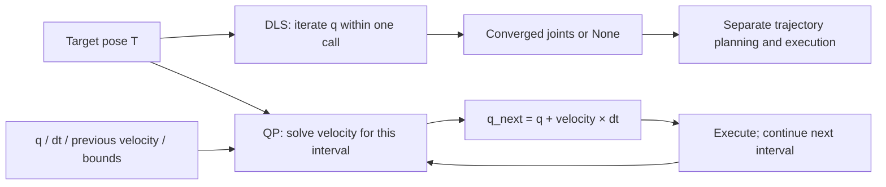
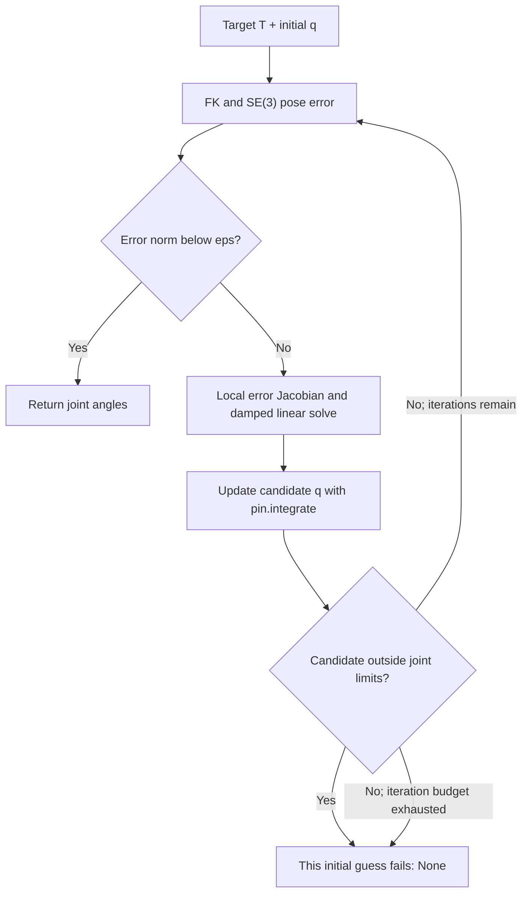
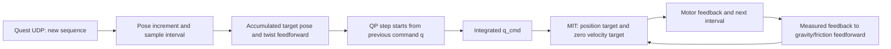
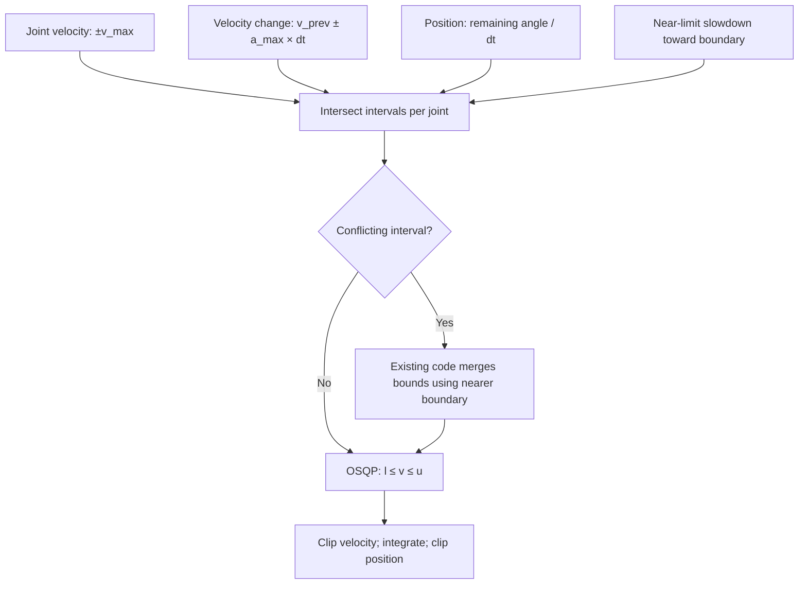

# Panthera: iterative DLS and QP inverse kinematics

[中文](README_IK_QP_CN.md) · [SDK overview](../../README.md)

**Scope: the current six-axis Panthera SDK in this directory; source checked on 2026-10-24.** This guide distinguishes implemented behavior, usage examples, and proposed extensions. The new examples calculate motion only; launching the VR scripts operates hardware.

The four flowcharts use embedded Mermaid and render in Markdown viewers with Mermaid support; no external image files are needed.

## 1. The main difference

DLS repeatedly updates joint angles within one function call to seek a target pose. This QP implementation computes a joint velocity for one control interval and integrates it into the next joint position. **QP is also numerical, and OSQP itself iterates. It is not an analytical IK solution.**

| Aspect | Current iterative DLS IK | Current velocity-level QP IK |
|---|---|---|
| Interface | `robot.inverse_kinematics(...)` | `solver.step(q, T, dt, ...)` |
| Output | Joint-angle `ndarray`, or `None` on failure | `QPIKResult`: next joint position, velocity, errors, status |
| Meaning of one call | Attempt to converge the pose error to a threshold | Find a suitable local motion for this interval |
| Joint position limits | A candidate outside the limits fails that initial guess | Convert position boundaries to velocity bounds; slow down near boundaries |
| Velocity / acceleration | Internal numerical step control, not physical control-interval constraints | Bound command velocity and changes between command velocities; see conflict handling in Section 6 |
| State | One or multiple initial guesses | Independent `previous_velocity` for each arm |
| Typical usage | Individual targets, offline reachability checks, path waypoints | Continuous hand-controller targets and incremental Cartesian tracking |
| Not guaranteed | All global solutions, trajectory continuity, collision avoidance | Reaching a target in one step, global reachability, collision avoidance, physical torque limits |



Figure 1. The upper branch's iterations belong to one solve; the lower branch's intervals form continuous tracking. Both need an external controller and feedback.

## 2. Source map, units, and frames

| File | Functions / variables to inspect |
|---|---|
| [Panthera.py](Panthera.py) | `inverse_kinematics`, `_inverse_kinematics_dls_single_impl`, `_inverse_kinematics_dls_multi_init_impl`, `forward_kinematics`, `get_jacobian` |
| [qp_ik.py](qp_ik.py) | `PinocchioOSQPIK.__init__`, `_velocity_bounds`, `step`, `reset`, `QPIKResult` |
| [Single-arm VR](../7_vr_cartesian_control.py) | `main` constructs `qp_solver` and calls `step` |
| [Dual-arm VR](../7_vr_dual_cartesian_control.py) | `create_arm_state`, `process_arm_control`, `sync_targets_to_current_state` |
| [Follower.yaml](../../robot_param/Follower.yaml) / [Leader.yaml](../../robot_param/Leader.yaml) | `joint_limits`, `velocity_limits`, `acceleration_limits`, `end_effector_link` |
| [Offline regression](../tests/test_vr_qp.py) | URDF convergence, independent arms, repeated packets, failure handling, gripper dispatch |

- Joint angles: rad; joint velocity: rad/s; joint acceleration: rad/s²; position: m; time: s.
- `T` is a 4×4 homogeneous transform: the upper-left 3×3 block is rotation and the upper-right 3×1 block is position. Targets and FK use the selected URDF model's base frame.
- The QP Jacobian uses `pin.LOCAL_WORLD_ALIGNED`: linear/angular components are expressed along base-aligned axes at the configured end-effector frame. `feedforward_twist = [vx, vy, vz, wx, wy, wz]`, in m/s and rad/s.
- Both current YAML files use `gripper_center_link` when a gripper is installed. With `gripper_installed: false`, the SDK uses `link6` and removes the gripper links from the dynamics model.
- The six coordinates follow `joint1 ... joint6`. The gripper is separate, not a seventh IK degree of freedom.

## 3. Calling DLS and understanding its iterations



Figure 2. Multiple-initialization mode wraps this same procedure with different starting points. A failed attempt is not proof that the target is unreachable.

A common DLS expression is `Δq = Jᵀ(JJᵀ + λ²I)⁻¹e`. This implementation uses the six-dimensional error `pin.log(current⁻¹ × target)`, a `Jlog6` correction, the corresponding negative descent direction, and an internal integration step of `0.1`. That step is not a motor-loop interval. Its internal vector-norm cap of `10.0` is not a per-joint hardware speed limit.

| Argument | Default | Actual meaning here |
|---|---|---|
| `target_position` | Required | Three-component position in the base frame |
| `target_rotation` | `None` | **Currently replaced with `np.eye(3)`: identity orientation is still requested** |
| `init_q` | `None` | In single-initialization mode, omission reads current joint angles |
| `multi_init` | `True` | Current feedback, zero, midpoint, random guesses; this branch ignores the supplied `init_q` |
| `num_attempts` | `8` | Maximum initial guesses to try |
| `max_iter` | `1000` | Maximum iterations per initial guess |
| `eps` | `1e-3` | Threshold on the six-dimensional SE(3) error norm; not simply 1 mm |
| `damping` | `1e-2` | Base DLS λ, used as λ² in the matrix |
| `adaptive_damping` | `True` | `λ_base × (1 + 1/(norm(error)+0.1))` |

**An existing docstring is inaccurate:** it describes `target_rotation=None` as position-only, while the code requests identity orientation. To hold the current orientation, pass the current FK rotation explicitly. To ignore orientation, change the DLS error/Jacobian task rows or use the QP zero-rotation-weight example in Section 7. This guide does not modify the solver.

### 3.1 Runnable offline model setup

Use the `panthera` environment with SDK dependencies installed, and run from this `scripts` directory. The adapter below borrows SDK mathematical methods without constructing `Panthera()` or the native `Robot()`: **it does not connect to motors**. Importing `Panthera_lib` still requires the installed `hightorque_robot` package. Put this setup and the Section 3.2 / 4.1 examples in the same Python session or file.

```python
from pathlib import Path
import numpy as np
import pinocchio as pin
import yaml
from Panthera_lib import Panthera
from Panthera_lib.qp_ik import PinocchioOSQPIK


class ModelOnly:
    # Reuse SDK math methods without inheriting or constructing hightorque_robot.Robot.
    forward_kinematics = Panthera.forward_kinematics
    get_jacobian = Panthera.get_jacobian
    inverse_kinematics = Panthera.inverse_kinematics
    _inverse_kinematics_dls_single_impl = Panthera._inverse_kinematics_dls_single_impl
    _inverse_kinematics_dls_multi_init_impl = Panthera._inverse_kinematics_dls_multi_init_impl

    def __init__(self, config_name="Follower.yaml"):
        path = Path("../robot_param") / config_name  # Run from scripts/.
        cfg = yaml.safe_load(path.read_text())
        self.model = pin.buildModelFromUrdf(str(path.parent / cfg["urdf"]["file_path"]))
        self.data = self.model.createData()
        self.joint_names = cfg["kinematics"]["joint_names"]
        self.motor_count = len(self.joint_names)
        self.end_effector_frame_id = self.model.getFrameId(cfg["urdf"]["end_effector_link"])
        self.joint_limits = {
            key: np.asarray(value, dtype=float)
            for key, value in cfg["robot"]["joint_limits"].items()
        }
        self.velocity_limits = np.asarray(cfg["robot"]["velocity_limits"], dtype=float)
        self.acceleration_limits = np.asarray(cfg["robot"]["acceleration_limits"], dtype=float)
        self.q0 = np.array([0.0, 0.6, 0.6, 0.0, 0.0, 0.0])

    def get_current_pos(self):
        return self.q0.copy()  # Offline seed; no encoder reads.


robot = ModelOnly("Follower.yaml")  # Also supports "Leader.yaml".
q0 = robot.get_current_pos()
q_goal = q0 + np.array([0.04, 0.03, -0.02, 0.02, -0.02, 0.01])
T_goal = robot.forward_kinematics(q_goal)["transform"]
```

The target is generated by FK so that a known reachable pose separates integration errors from an arbitrary unreachable target. The starting angles are an offline example only.

### 3.2 Single-initialization DLS

```python
q_solution = robot.inverse_kinematics(
    target_position=T_goal[:3, 3],
    target_rotation=T_goal[:3, :3],
    init_q=q0,
    multi_init=False,
    max_iter=1000,
    eps=1e-3,
    damping=1e-2,
    adaptive_damping=True,
)
if q_solution is None:
    raise RuntimeError("DLS did not converge; no command was sent")
T_check = robot.forward_kinematics(q_solution)["transform"]
print("DLS joints [rad]:", q_solution)
print("DLS position error [m]:", np.linalg.norm(T_check[:3, 3] - T_goal[:3, 3]))
```

For successive targets, explicitly use `init_q=last_valid_joint_angles, multi_init=False`. For independent targets, `multi_init=True` may help, but random guesses can select another branch and increase runtime. A returned angle vector is not an executed trajectory; do not treat a distant solution as a small continuous-control command.

## 4. Calling QP and reading its result

### 4.1 One solver, repeated steps

Continue after the offline setup in Section 3.1:

```python
solver = PinocchioOSQPIK(
    robot,
    max_joint_velocity=0.8,
    max_joint_acceleration=2.0,
    max_linear_velocity=0.25,
    max_angular_velocity=0.8,
)
q_cmd = q0.copy()
solver.reset()
dt = 0.01  # Offline simulated interval; not a sleep or a hardware cycle.
for _ in range(300):
    result = solver.step(
        joint=q_cmd,
        target_transform=T_goal,
        dt=dt,
        feedforward_twist=np.zeros(6),
    )
    q_cmd = result.joint_position.copy()
print("QP joints [rad]:", q_cmd)
print("QP errors [m, rad]:", result.position_error, result.rotation_error)
print("OSQP status / internal iterations:", result.status, result.iterations)
```

`step()` calculates only; it sends no motor commands. `reset()` clears the previous joint velocity and is normally used on disengagement or reinitialization. Resetting every frame destroys the intended velocity history and smoothing term.

| Result field | Meaning |
|---|---|
| `joint_position` | Next command joint angles, rad |
| `joint_velocity` | QP command velocity, rad/s; final position clipping can make it differ from the position increment divided by dt |
| `position_error` | Euclidean error between predicted next-step FK and the target, m |
| `rotation_error` | Relative rotation angle between predicted next-step FK and the target, rad |
| `status` | OSQP status string; the code accepts status values 1 and 2, including `solved inaccurate` |
| `iterations` | OSQP's internal iterations for this solve, not controller-loop iterations |

These are **model-predicted errors**, not measured tracking errors. Compute actual tracking error separately using FK of `get_current_pos()`. Failures can raise `ValueError` / `RuntimeError`; the calling controller must handle exceptions and rejected SDK commands rather than accept invalid results.

### 4.2 Current VR command flow



Figure 3. QP velocity generates a position trajectory. The current VR scripts still send a zero MIT velocity target; they do not send QP velocity as the MIT velocity target.

- Single arm: right controller to default Follower. Dual arm: left to Leader, right to Follower, with independent solvers, histories, and targets.
- Pose increments are accumulated once per new UDP sequence. Twist feedforward uses the interval between hand samples; QP `dt` uses the controller-period estimate. These intervals are not interchangeable.
- The single-arm loop targets 120 Hz. The dual-arm loop uses `control_rate=0.01 s` and sleeps after computation, so the actual period includes computation time. Both clip the QP interval estimate to 0.5–2 times the nominal period, rather than representing every actual delay exactly.
- Integrating from the last command avoids restarting from lagging encoder feedback every frame, but command and actual position can diverge. Monitor tracking error separately; do not compensate for a long interruption by using a huge `dt`.
- Squeeze release resynchronizes targets to feedback. The single-arm invalid-input branch holds the last valid command. The dual-arm invalid-input branch resets target/QP state and returns; its hold-command dispatch is not identical to the single-arm implementation.
- `VR_HAND_VELOCITY_TIMEOUT=0.05` clears stale hand-velocity feedforward only. The old pose target can still be tracked; this is not a complete UDP-disconnection stop mechanism.
- `gripper_control_MIT(..., send=False)` queues a gripper command for the single arm's joint dispatch in the same interval. A QP-failure branch also flushes commands explicitly. Default `send=True` preserves the existing interface behavior.

Both scripts move to a preset pose at startup and attempt to return to zero during shutdown. After about ten seconds without hand data, startup still proceeds to robot initialization. Running the scripts is not an offline import test. Launch commands are in the [SDK overview](../../README.md).

### 4.3 Integrating with an already connected robot (sends commands)

These fragments show interface integration only; they are not part of the runnable offline example. The caller owns the confirmed robot connection, target and execution authorization, feedback, scheduling, and hold/stop handling. No robot is constructed and no loop starts automatically here.

```python
# LIVE INTEGRATION FRAGMENTS: calling these functions sends motor commands.
# robot must already be connected and configured by the caller.
def execute_dls_target(robot, target_position, target_rotation, duration):
    q_solution = robot.inverse_kinematics(
        target_position=target_position,
        target_rotation=target_rotation,
        init_q=robot.get_current_pos(),
        multi_init=False,
    )
    if q_solution is None:
        raise RuntimeError("DLS failed; target was not sent")
    return robot.moveJ(q_solution.tolist(), duration=duration, iswait=True)


def send_qp_step(robot, solver, q_cmd, T_target, dt, twist_ff, tau_ff, kp, kd):
    try:
        result = solver.step(q_cmd, T_target, dt, feedforward_twist=twist_ff)
    except (RuntimeError, ValueError):
        solver.reset()
        raise  # Caller must apply its hold/stop policy.
    accepted = robot.pos_vel_tqe_kp_kd(
        pos=result.joint_position.tolist(),
        vel=[0.0] * robot.motor_count,  # Matches current VR position tracking.
        tqe=np.asarray(tau_ff).tolist(),
        kp=kp,
        kd=kd,
    )
    if not accepted:
        solver.reset()
        raise RuntimeError("SDK rejected the command")
    return result  # Only now accept result.joint_position as the next q_cmd.
```

The DLS function solves target joint angles and then calls `moveJ`. Current `moveJ` computes average velocity from displacement/duration and delegates to `Joint_Pos_Vel`; it is not a complete polynomial trajectory planner and does not guarantee arrival exactly at `duration`.

The QP function handles one interval. Construct `solver` once at control entry and initialize `q_cmd=robot.get_current_pos()`. Call periodically and update `q_cmd` from `result.joint_position.copy()` only on success. The caller supplies `tau_ff`, `kp`, and `kd` for its control scheme; see the VR gravity/friction feedforward and torque clipping. The outer controller must handle exceptions: `reset()` itself does not stop motors or return them to zero.

## 5. What the QP minimizes

Let `v` be the joint velocity being solved, `v_prev` the preceding command velocity, `J` the end-effector Jacobian, and `b` the desired task twist. The current objective is equivalent to:

$$
\min_v\; \frac12(Jv-b)^T W(Jv-b)
+\frac{d}{2}\|v\|^2+\frac{s}{2}\|v-v_{prev}\|^2
$$

Here `W=diag(position_weight × 3, rotation_weight × 3)`, `d=damping`, and `s=smoothness`.

$$
P=J^TWJ+(d+s)I,\qquad g=-J^TWb-sv_{prev},\qquad l\le Iv\le u
$$

The `q` in `solver.setup(q=gradient)` is OSQP's linear cost vector `g`, not the robot's joint angles.

The desired task twist is constructed as:

$$
b_{lin}=\operatorname{clipNorm}(K_p(p^*-p)+v_{ff},V_{lin}),\quad
b_{ang}=\operatorname{clipNorm}(K_R\operatorname{rotvec}(R^*R^T)+\omega_{ff},V_{ang})
$$

Position and rotation weights determine a tradeoff between task residuals with different physical units. Gains convert errors to desired velocities. QP `damping` is a joint-velocity regularization coefficient, not the DLS λ; their numerical values are not interchangeable.

**Implementation detail:** each arm's Python solver retains `previous_velocity`, but `step()` creates a fresh OSQP instance and calls `setup()` every time, then warm-starts with the previous velocity. It does not reuse OSQP matrix-factorization caches. Persistent history does not mean a persistent OSQP workspace or guaranteed hard real-time execution.

## 6. How bounds are formed, and what is not a hard constraint



Figure 4. These bounds act on the command trajectory. When intervals conflict or final position clipping occurs, recheck whether the original velocity and acceleration bounds still hold.

For each joint i, define `qL = lower + margin` and `qU = upper - margin`:

| Bound / operation | Expression | Where to change it |
|---|---|---|
| Joint velocity | `-v_max ≤ v ≤ v_max` | `solver.velocity_limit` |
| Command acceleration | `v_prev-a_max*dt ≤ v ≤ v_prev+a_max*dt` | `solver.acceleration_limit` |
| Next position | `(qL-q)/dt ≤ v ≤ (qU-q)/dt` | YAML limits and `joint_limit_margin` |
| Slowdown near lower limit | `v ≥ -v_max*clip((q-qL)/D, 0, 1)` | `joint_limit_slowdown_distance=D` |
| Slowdown near upper limit | `v ≤ v_max*clip((qU-q)/D, 0, 1)` | Same; `D<=0` disables this slowdown |
| Cartesian speed parameters | Clip the 3D norm of desired `b` | `max_linear_velocity` / `max_angular_velocity` |
| Smoothing | Penalize `||v-v_prev||²`; a soft objective | `smoothness` |

**Important distinctions:**

1. The current hard-constraint matrix is the identity and bounds joint velocity only. Limiting desired task twist `b` is not a hard bound on achieved `Jv`.
2. On interval conflict, `_velocity_bounds()` selects the nearer position boundary and replaces one interval endpoint with the other. This can relax an original velocity/acceleration condition. `next_joint` is also clipped afterward, so all bounds are not unconditionally guaranteed together. Starting outside the position margin needs particular handling.
3. Acceleration bounds constrain successive **command velocities**, not measured physical motor acceleration. Sampling, feedback lag, and the low-level controller affect actual motion.
4. There are no collision, self-collision, inter-arm collision, obstacle, jerk, dynamic torque, or current constraints. VR feedforward-torque clipping does not bound the total MIT closed-loop torque.
5. An unreachable target may still produce locally feasible steps or stagnation. `solved` refers to the local QP, not to having reached the requested pose.

**Numerical example:** with `dt=0.01`, `v_max=0.5`, `a_max=1.0`, `v_prev=0.1`, and ample position clearance, the next velocity interval is `[0.09, 0.11] rad/s`, allowing at most `0.0011 rad` of motion. If only `0.0005 rad` remains before the upper boundary, position requires `v<=0.05`, conflicting with the acceleration lower bound of `0.09`. The current implementation adjusts the interval for the position boundary; do not assume `a_max=1.0` still holds strictly in that case.

## 7. Changing parameters: defaults, VR overrides, and examples

### 7.1 QP class defaults

| Parameter | Default | Effect of adjustment |
|---|---|---|
| `position_weight` | `100.0` | Higher values emphasize position residuals |
| `rotation_weight` | `2.0` | Higher values emphasize orientation; zero removes its cost |
| `position_gain` / `rotation_gain` | `6.0` / `4.0` | Error-to-desired-velocity gains; high gains reach limits sooner |
| `damping` | `1e-3` | Higher values penalize large joint velocities more |
| `smoothness` | `2e-2` | Higher values favor the preceding velocity, potentially adding lag |
| `max_joint_velocity` | `0.8 rad/s` | Minimum with each YAML joint velocity at construction |
| `max_joint_acceleration` | `2.0 rad/s²` | Minimum with each YAML joint acceleration at construction |
| `max_linear_velocity` | `0.25 m/s` | Desired linear-twist norm cap |
| `max_angular_velocity` | `0.8 rad/s` | Desired angular-twist norm cap |
| `joint_limit_margin` | `0.005 rad` | Shrinks both position boundaries inward; an excessive margin can invalidate the interval |
| `joint_limit_slowdown_distance` | `0.15 rad` | Distance over which motion toward a boundary slows down |

Constructor arguments `max_joint_velocity` / `max_joint_acceleration` currently accept scalars. To set per-joint values, assign the resulting `velocity_limit` / `acceleration_limit` arrays after construction. Each must contain six nonnegative values; use positive values for ordinary finite bounds. Handle velocity-history consistency when changing limits, parameters, or control state.

```python
# Apply AFTER constructing solver; vectors follow joint1 ... joint6.
requested_velocity = np.array([0.4, 0.4, 0.4, 0.5, 0.5, 0.5])
requested_acceleration = np.array([0.8, 0.8, 0.8, 1.0, 1.0, 1.0])
solver.velocity_limit = np.minimum(requested_velocity, robot.velocity_limits)
solver.acceleration_limit = np.minimum(requested_acceleration, robot.acceleration_limits)
solver.max_linear_velocity = 0.10
solver.max_angular_velocity = 0.40
solver.joint_limit_margin = 0.01
solver.joint_limit_slowdown_distance = 0.20
solver.reset()  # Use when disengaged/reinitialized, not on every control step.
```

These numbers illustrate the editing method; they are not tuned or validated for a physical payload. The class does not comprehensively validate externally modified parameters. Check dimensions, finite values, limit ordering, and the current position.

### 7.2 What the current VR scripts override

| Setting | QP default | Both current VR scripts |
|---|---|---|
| Per-joint velocity | `min(0.8, YAML)` | `[3,3,3,3,4,4] rad/s`, assigned directly after construction |
| Per-joint acceleration | `min(2.0, YAML)` | All `inf`; no clipping |
| Desired linear / angular twist | `0.25 / 0.8` | Both `inf` |
| Position bounds | YAML plus margin | Still used |

Both current YAML configurations specify velocity `[1,1,1,1,1,1]` and acceleration `[2,2,2,2,2,2]`. **Editing YAML alone does not remove the VR velocity/acceleration overrides.**

Change the direct assignments after solver construction in single-arm `main()` and dual-arm `create_arm_state()`, as well as the constants at the top of both scripts. For example:

```python
# Replace the existing constants near the top of BOTH VR scripts.
VR_MAX_JOINT_VELOCITY = np.array([0.4, 0.4, 0.4, 0.5, 0.5, 0.5], dtype=float)
VR_MAX_JOINT_ACCELERATION = np.array([0.8, 0.8, 0.8, 1.0, 1.0, 1.0], dtype=float)
VR_MAX_LINEAR_VELOCITY = 0.10
VR_MAX_ANGULAR_VELOCITY = 0.40

# Replace the two existing direct assignments after QP construction.
# The local variable is named qp_solver in both scripts.
qp_solver.velocity_limit = np.minimum(VR_MAX_JOINT_VELOCITY, robot.velocity_limits)
qp_solver.acceleration_limit = np.minimum(VR_MAX_JOINT_ACCELERATION, robot.acceleration_limits)
```

This is an editing guide; it does not automatically modify the scripts. Update both VR entrypoints separately. Model and ordinary DLS configuration need not change with them. To use QP class defaults directly, remove the two overrides and omit the infinite Cartesian-speed arguments passed to the constructor.

### 7.3 Position-only tracking

```python
position_solver = PinocchioOSQPIK(robot, rotation_weight=0.0)
T_position = robot.forward_kinematics(q0)["transform"].copy()
T_position[:3, 3] = T_goal[:3, 3]
position_step = position_solver.step(q0, T_position, 0.01)
# Rotation is unpenalized, not held fixed; a valid 4x4 transform is still required.
```

`rotation_weight=0` removes orientation cost; it does not hold the current orientation. Orientation can change as the joints move. For full-pose tracking, keep a positive rotation weight and specify the target rotation explicitly.

## 8. Where to add new constraints

### 8.1 Hard per-axis Cartesian velocity bounds (proposed; not implemented)

To limit the actual linearized task velocity `Jv`, replace `A=I` with a stacked matrix such as `A=[I; J]`, expanding `l/u` accordingly. This demonstrates assembly only; it is not a complete replacement for `step()`:

```python
# DESIGN EXAMPLE ONLY: replace the A/l/u construction inside step().
# Existing local variables: jacobian, lower, upper, self.count.
from scipy.sparse import csc_matrix, eye, vstack

cartesian_axis_caps = np.array([0.10, 0.10, 0.10, 0.40, 0.40, 0.40])
A_aug = vstack([eye(self.count, format="csc"), csc_matrix(jacobian)], format="csc")
l_aug = np.concatenate([lower, -cartesian_axis_caps])
u_aug = np.concatenate([upper, cartesian_axis_caps])
# Then pass A=A_aug, l=l_aug, u=u_aug to solver.setup(...).
# After solving AND any post-processing, verify l_aug <= A_aug @ velocity <= u_aug
# with a numerical tolerance before accepting the command.
```

These are componentwise bounds, not a 3D Euclidean norm ball. If all three linear components equal `0.1`, total speed can reach `sqrt(3)*0.1`. Added constraints require infeasibility handling. The existing componentwise post-solve `clip` can violate new coupled constraints and must not be retained without checking them again. Final position clipping also changes the implied velocity.

### 8.2 Other extensions

| Desired feature | Mathematical / code direction | Additional requirements |
|---|---|---|
| Workspace plane | Linearize `nᵀ(p + J_pos v dt) <= c` and add a constraint row | Plane frame, TCP / geometry, finite-step error checks |
| Collision distance | Distance Jacobian produces a velocity inequality | Collision geometry, distances, gradients; not just a YAML edit |
| Jerk | Retain earlier velocity; bound `(v-2*v_prev+v_prevprev)/dt²` for equal intervals | More history, variable-interval derivation, transition handling |
| Task priorities | Hierarchical QP or strict-priority constraints | Large weights give tradeoffs, not strict priority |
| Torque / current limits | Include dynamics and low-level control relationships | The current unknown is velocity only; `tau_limit` is not a velocity constraint |

Modify `_velocity_bounds()` for per-joint intervals and `A/l/u` in `step()` for coupled linear constraints. Modify `weights/hessian/gradient` for objective preferences. With any new constraint, validate the solve, post-processing, and measured tracking error.

## 9. Troubleshooting and validation

| Symptom | Check first |
|---|---|
| DLS fails at a seemingly reachable position | Accidental `target_rotation=None`, wrong TCP, or an iteration crossing limits |
| `init_q` appears ignored | Whether default `multi_init=True` is still enabled |
| QP reports `solved` but the arm is not at the target | One solve is one step; inspect subsequent error, limits, and reachability |
| Motion stays fast after YAML edits | Direct post-construction VR overrides |
| QP jitter or lag | Hand-sample intervals, repeated packets, weights/gains, limits, resets, command/feedback divergence |
| OSQP exception | Dimensions, NaN/Inf inputs, invalid dt, interval conflict, numerical conditioning |
| `import pinocchio` fails | Use the project Conda environment; the robotics distribution is named `pin`; avoid mixed ROS Python paths |

Offline test command, run from this directory:

```bash
conda activate panthera
python -m unittest discover -s tests -p test_vr_qp.py -v
```

The regression uses current URDFs and numerical interfaces, blocks hardware initialization, and covers six tests. Run this guide's offline examples with both Leader and Follower models as well. Actual position accuracy, velocities, communication timing, and collisions require separate physical measurements; offline results do not replace hardware validation.

### Local results for the offline examples

These results use the single nearby reachable target generated in Section 3.1: one DLS call and 300 simulated QP steps. They validate the interface and that target, not accuracy throughout the workspace or on physical hardware.

| Model | DLS position error (m) | QP position error (m) | QP orientation error (rad) |
|---|---:|---:|---:|
| Follower | `5.30e-4` | `2.00e-10` | `3.00e-7` |
| Leader | `4.28e-4` | `1.23e-10` | `3.28e-7` |

Environment: NumPy 1.26.4, SciPy 1.15.3, Pinocchio 3.9.0, OSQP 1.1.3. Numerical results may vary slightly across versions.
